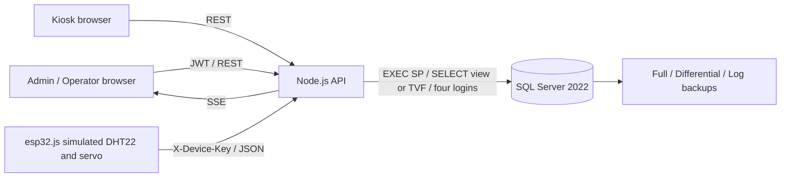
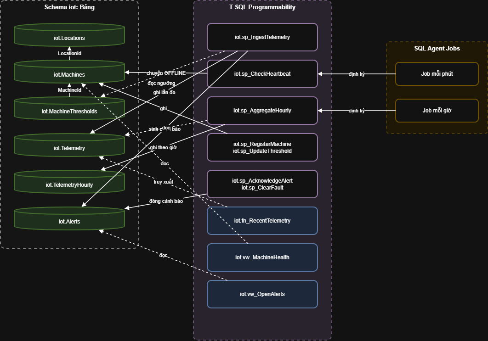
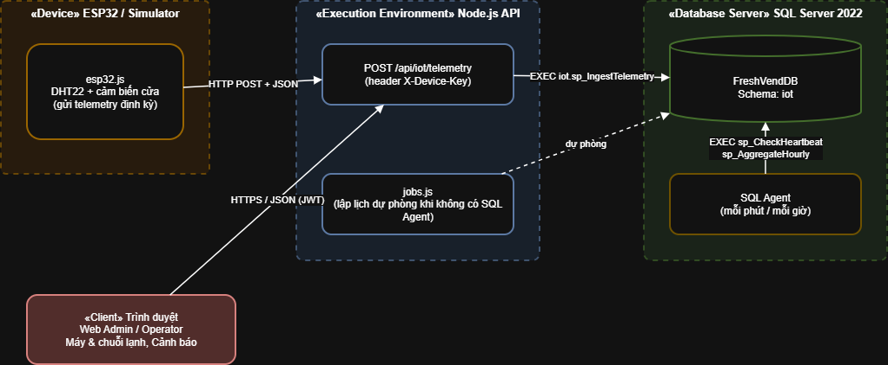
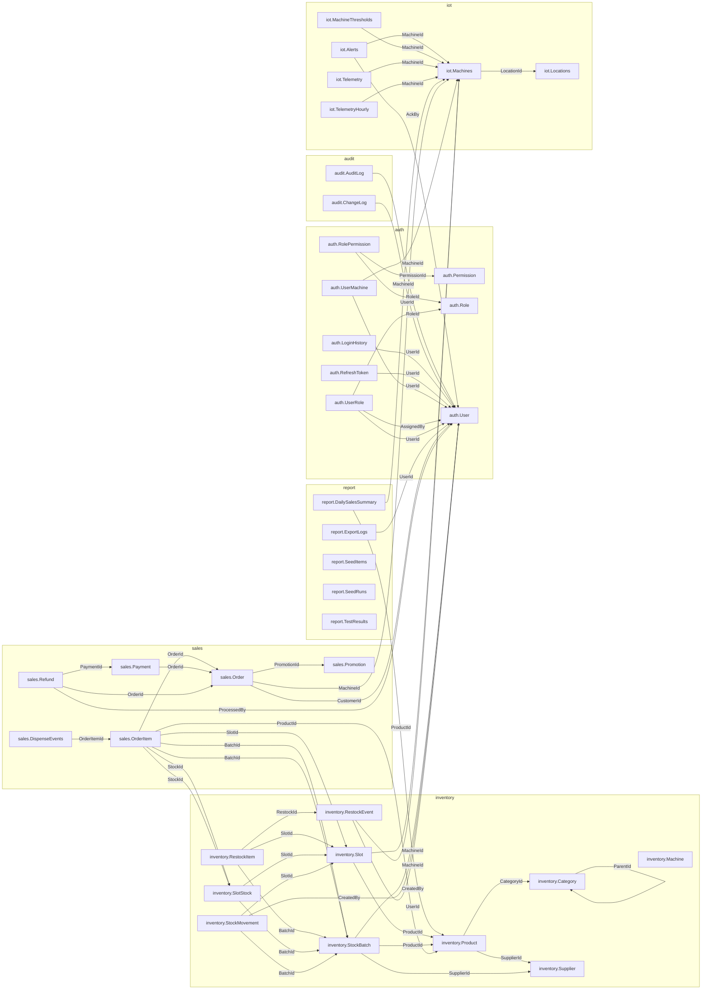
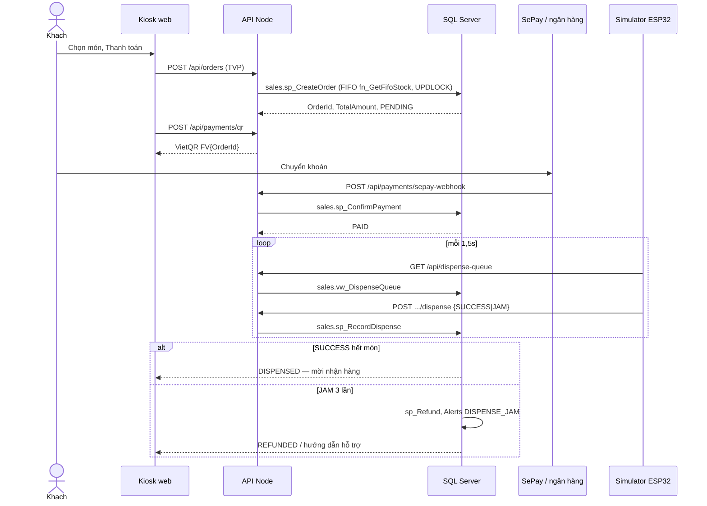
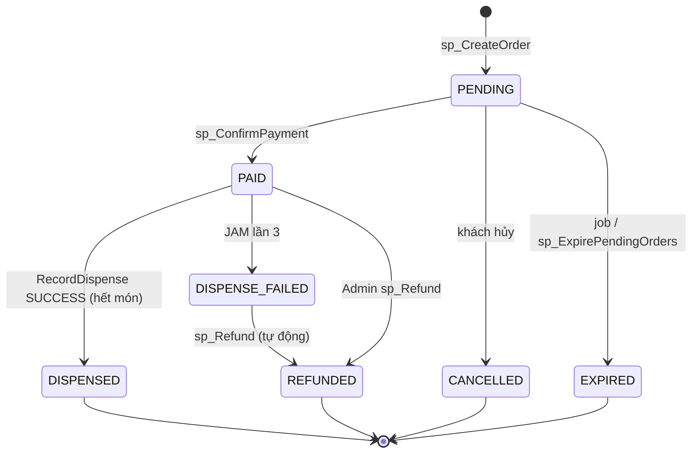

# FreshVend — Báo cáo tổng hợp

**SCRUM-240 / FV-46 · Bản ghép 1.0 · Ngày tổng hợp: 15/11/2026 (UTC+7)**  
Biên tập: Nguyễn Phạm Xuân Anh. Người đọc chéo: Nguyễn Phương Huy — **chưa có xác nhận review**.

| Thành viên | Phần phụ trách |
|---|---|
| Nguyễn Phương Huy | Leader, inventory, URS/SRS, review |
| Huỳnh Nhật Toàn | auth/audit, phân quyền, backup, ERD |
| Đoàn Phương Thiên Ân | sales, kiosk, Docker, thiết kế chi tiết |
| Trương Tuấn Dũng | IoT, kiến trúc, simulator, vận hành máy |
| Nguyễn Phạm Xuân Anh | report, QA, Test Report, manual Admin, ghép báo cáo |

Báo cáo mô tả sản phẩm theo mã hiện có và các lần chạy thật. Không phải biên bản nghiệm thu toàn hệ thống. Đề mục yêu cầu được nhóm ghi trong NHIEM_VU_CHI_TIET; bản đề gốc mục e) không có trong repo để đối chiếu độc lập. Bảng sau bao phủ sáu nhóm tài liệu theo hướng dẫn FV-46.

| Nhóm tài liệu | Chương | Nguồn / tình trạng |
|---|---|---|
| URS/SRS | 1 | SRS hiện là draft; chờ FV-34 của Huy |
| Kiến trúc và ERD | 2–3 | Hai ảnh diagram, topology FK và dictionary từ SQL thật; chờ tài liệu FV-37/FV-42 được owner duyệt |
| Thiết kế chi tiết | 4 | Ghép DetailedDesign của nhóm |
| Triển khai và kiểm thử | 5–6 | Script module, Test Plan và Test Report có log thật |
| Cài đặt | 7 | Bộ cài đã chạy, runbook backup; chưa có xác nhận cài chéo máy khác |
| Ba user manual | 8 | Admin đầy đủ; Customer/Operator có quy trình đối chiếu UI hiện có, chờ bản chính thức và ảnh SQL thật từ owner |

Ngày trên bìa là ngày ghép; ngày trong tài liệu nguồn và log được giữ để truy vết, không đổi thành ngày hôm nay. SQL Server 2022 là nền tảng thực tế, Node.js theo package/lockfile; thiết bị là **mô phỏng bằng app/simulator/esp32.js**, không phải phần cứng đã lắp. Thanh toán trong kiểm thử không phải giao dịch ngân hàng thật.

## Mục lục

1. [Yêu cầu và phạm vi](#yeu-cau)
2. [Kiến trúc](#kien-truc)
3. [Thiết kế dữ liệu, ERD và từ điển](#du-lieu)
4. [Thiết kế chi tiết](#thiet-ke)
5. [Triển khai](#trien-khai)
6. [Kiểm thử](#kiem-thu)
7. [Cài đặt và sao lưu](#cai-dat)
8. [Ba hướng dẫn người dùng](#huong-dan)
9. [Nguồn bàn giao, giới hạn và review](#ban-giao)

<a id="yeu-cau"></a>

## 1. Yêu cầu và phạm vi

Hệ thống hỗ trợ quản lý đội máy bán trái cây, châm hàng theo lô/hạn dùng, mua tại kiosk, ghi nhận thanh toán và nhả hàng, telemetry/cảnh báo và báo cáo cho Admin. Khách thao tác kiosk đã được kích hoạt; Operator chỉ thao tác máy được giao; Admin xem doanh thu toàn đội và quản lý tài khoản. Các yêu cầu mục tiêu như phản hồi dưới 500 ms, uptime 99,9%, kẹt dưới 2% phải được đo, không suy ra từ số lượng file SQL.

Ma trận truy vết biên tập từ các module có thật:

| Yêu cầu | Thành phần | Kiểm chứng hiện hành |
|---|---|---|
| Đăng nhập và quản lý quyền | auth/audit, 10/20/40 | 18/18 auth, audit 10/10, security 11/11 |
| Tồn kho, temporal, TVP/FIFO | inventory, 11/21/30 | 53/54 unit; temporal T48 chưa đạt |
| Mua, thanh toán, nhả | sales, 12/22 | SQL sales 5/5; tạo đơn qua API đang lỗi TVP |
| Cảm biến/cảnh báo | iot, 13/23 | ingest 6/6; cảnh báo và reconnect chưa đạt mô phỏng |
| Phân tích và CSV | report, 14/24 | sáu ca report PASS trong runner; chưa nghiệm thu PDF |
| Sao lưu và STOPAT | 50_backup, demo_security | Full/Diff/Log và restore thực PASS; chưa chứng minh HA/RPO=0 |

Các số trên là tóm tắt Test Report của bản nhánh, không áp cho main trước khi merge. Sau đây là SRS nguồn và User Story bán hàng, giữ nguyên để Huy tiếp tục hoàn thiện.

> Nguồn ghép: [SRS.md](SRS.md). Giữ nội dung kỹ thuật và ngày nguồn; các nhận định lịch sử không thay kết quả kiểm thử hiện hành.

# SRS — Đặc tả Yêu cầu Phần mềm

> **Dự án:** FreshVend  
> **Phiên bản tài liệu:** 0.1 (draft)  
> **Ngày:** 2026-10-21  

---

## 1. Giới thiệu

*(Điền mô tả tổng quan hệ thống, phạm vi, các bên liên quan…)*

## 2. Yêu cầu chức năng

| ID | Module | Mô tả yêu cầu | Ưu tiên |
|----|--------|---------------|---------|
| FR-01 | auth | Hệ thống cho phép đăng nhập bằng username/password | Cao |
| FR-02 | inventory | Quản trị viên có thể thêm/sửa/xoá sản phẩm | Cao |
| FR-03 | sales | Khách hàng mua hàng tại máy, thanh toán QR | Cao |
| FR-04 | iot | Hệ thống nhận dữ liệu nhiệt độ từ ESP32 mỗi 30 giây | Trung bình |
| FR-05 | report | Hệ thống tạo báo cáo doanh thu hàng ngày | Trung bình |

## 3. Yêu cầu phi chức năng

*(Hiệu năng, bảo mật, khả năng mở rộng…)*

## 4. Ràng buộc hệ thống

*(SQL Server 2019+, collation Vietnamese_CI_AS…)*


> Nguồn ghép: [UserStories_Sales.md](UserStories_Sales.md). Giữ nội dung kỹ thuật và ngày nguồn; các nhận định lịch sử không thay kết quả kiểm thử hiện hành.

# User Story — Module Bán hàng 

> **Dự án:** FreshVend — máy bán trái cây tươi tự động  
> **Module:** `sales` (Kiosk + đơn hàng + thanh toán QR)  
> **Sản phẩm kèm:** [`State.drawio`](./State.drawio) — State Diagram trạng thái đơn hàng  

---

## 1. Actor

| Actor | Mô tả |
|-------|--------|
| **Khách hàng** | Người mua tại máy (kiosk), không cần đăng nhập |
| **Hệ thống** | API + job hết hạn đơn + webhook ngân hàng + bộ điều khiển máy |
| **Nhân viên / Admin** | Theo dõi đơn, xác nhận tiền thủ công, hoàn tiền khi cần |

---

## 2. User Story khách hàng

### US-S01 — Xem sản phẩm tại máy
**Là** khách hàng đứng trước máy FreshVend,  
**tôi muốn** xem danh sách sản phẩm còn hàng (tên, giá, ảnh),  
**để** chọn món phù hợp trước khi mua.

**Acceptance criteria**
- [ ] Kiosk chỉ hiện sản phẩm còn tồn tại máy đang dùng
- [ ] Hiển thị tên, giá, ảnh sản phẩm rõ ràng trên màn hình cảm ứng

---

### US-S02 — Giỏ hàng / chọn số lượng
**Là** khách hàng,  
**tôi muốn** thêm/bớt sản phẩm vào giỏ và xem tổng tiền,  
**để** kiểm soát đơn trước khi thanh toán.

**Acceptance criteria**
- [ ] Có thể thêm, tăng/giảm, xoá món trong giỏ
- [ ] Tổng tiền cập nhật đúng theo đơn giá × số lượng
- [ ] Không cho đặt vượt số lượng còn trong khay

---

### US-S03 — Thanh toán QR dưới 30 giây
**Là** khách hàng,  
**tôi muốn** thanh toán bằng mã VietQR và được hệ thống xác nhận nhanh,  
**để** không phải chờ lâu tại máy.

**Acceptance criteria**
- [ ] Sau khi bấm thanh toán, đơn ở trạng thái `PENDING` và hiện mã VietQR (số TK, số tiền, nội dung `FV…`)
- [ ] Khi tiền về (webhook) hoặc admin xác nhận, đơn chuyển `PENDING` → `PAID`
- [ ] Thời gian từ lúc quét/chuyển khoản thành công đến khi kiosk nhận trạng thái `PAID` **< 30 giây** (trong điều kiện mạng bình thường)
- [ ] Đơn `PENDING` quá **5 phút** tự chuyển `EXPIRED`, trả hàng về kho

---

### US-S04 — Nhận hàng
**Là** khách hàng đã thanh toán thành công,  
**tôi muốn** máy nhả đúng sản phẩm đã mua,  
**để** hoàn tất giao dịch.

**Acceptance criteria**
- [ ] Sau `PAID`, bộ điều khiển máy thực hiện nhả hàng
- [ ] Nhả thành công → đơn `DISPENSED`, kiosk báo “Mời nhận hàng”
- [ ] Màn hình theo dõi trạng thái đơn; không tự “giả” đã thanh toán/nhả hàng

---

### US-S05 — Thông báo khi kẹt hàng / hoàn tiền
**Là** khách hàng,  
**tôi muốn** được thông báo rõ khi máy kẹt hàng và biết đã/được hoàn tiền,  
**để** không mất tiền khi không nhận được hàng.

**Acceptance criteria**
- [ ] Nhả hàng thất bại → `PAID` → `DISPENSE_FAILED`, kiosk hiện thông báo lỗi / hướng dẫn hỗ trợ
- [ ] Hệ thống hoàn tiền → `DISPENSE_FAILED` → `REFUNDED` (tự động sau đủ lần thử lỗi, hoặc thao tác staff)
- [ ] Kiosk hiển thị trạng thái hoàn tiền; có hotline hỗ trợ khi cần

---

## 3. State Diagram đơn hàng (tóm tắt)

Luồng bắt buộc (chi tiết trong `docs/State.drawio`):

```
                    ┌──────────┐
                    │ EXPIRED  │  (cuối)
                    └────▲─────┘
                         │ quá 5 phút
┌───────┐   tạo đơn   ┌──┴──────┐  xác nhận tiền   ┌──────┐  nhả OK   ┌───────────┐
│ start │────────────►│ PENDING │─────────────────►│ PAID │─────────►│ DISPENSED │ (cuối)
└───────┘             └─────────┘                  └──┬───┘          └───────────┘
                                                      │ kẹt / lỗi
                                                      ▼
                                              ┌────────────────┐  hoàn tiền  ┌──────────┐
                                              │ DISPENSE_FAILED│────────────►│ REFUNDED │ (cuối)
                                              └────────────────┘             └──────────┘
```

| Từ | Đến | Điều kiện |
|----|-----|-----------|
| — | `PENDING` | Khách tạo đơn trên kiosk |
| `PENDING` | `PAID` | Thanh toán QR thành công (webhook / xác nhận) |
| `PENDING` | `EXPIRED` | Quá 5 phút chưa thanh toán |
| `PAID` | `DISPENSED` | Nhả hàng thành công |
| `PAID` | `DISPENSE_FAILED` | Kẹt / nhả thất bại |
| `DISPENSE_FAILED` | `REFUNDED` | Hoàn tiền cho khách |

---

## 4. Liên kết FR trong SRS

| User Story | FR (SRS) |
|------------|----------|
| US-S01 … US-S05 | **FR-03** — Khách hàng mua hàng tại máy, thanh toán QR |


<a id="kien-truc"></a>

## 2. Kiến trúc

Trình duyệt Admin/Operator và kiosk gọi REST API Node.js. API kiểm tra JWT/vai trò, bind tham số rồi EXEC stored procedure hoặc SELECT view/TVF qua bốn login SQL. RLS lọc máy theo SESSION_CONTEXT. Simulator gửi telemetry và kết quả nhả bằng khóa thiết bị. SSE cập nhật đội máy/cảnh báo trên UI. DB_MODE=demo dùng fakeDb; DB_MODE=sqlserver dùng SQL Server thật. Mô tả đối chiếu app/api/src/db.js, app/api/src/routes, app/web/js/admin.js và app/simulator/esp32.js, không thay tài liệu kiến trúc chính thức của Dũng.



Sơ đồ thành phần và triển khai do nhóm đã có trong repo; chưa có biên bản review cập nhật của owner:





Điểm cần chốt: hợp nhất nguồn máy, UTC thống nhất, ba đối tượng API IoT, lịch job/partition và hợp đồng duration của TelemetryHourly. Docker có Dockerfile/compose nhưng chưa chạy trong đợt kiểm tra này. Không coi sơ đồ biểu diễn là bằng chứng triển khai đầy đủ.

<a id="du-lieu"></a>

## 3. Thiết kế dữ liệu, topology ERD và Data Dictionary

Sáu schema: auth, audit, inventory, sales, iot, report. Snapshot từ CSDL QA thật đã dựng bằng bộ cài, metadata đọc bằng tools/export-report-schema.ps1; [JSON ngày giờ/đối tượng](evidence/SCRUM-240/schema.json). Snapshot có cả temporal history và hai bảng máy hiện tại, không vẽ schema đích thay schema đang chạy.

Các mối liên hệ chính: User–Role–UserRole, User–UserMachine–Machines, Location–Machines, Machine–Slot–SlotStock–StockBatch–Product, Order–OrderItem–Payment–DispenseEvents, Machine–Telemetry/TelemetryHourly/Alerts và User–ExportLogs. Khóa ngoại chéo schema tập trung ở 03_foreign_keys.sql; các khóa trong schema ở script bảng tương ứng.

Sơ đồ dưới chỉ thể hiện chiều FK từ bảng con sang bảng cha, nhãn là cột FK; không suy diễn cardinality/unique composite từ sơ đồ. Đây là phụ lục tự trích từ DB, **không thay ERD.png/DataDictionary được Toàn review trong FV-37**. [Từ điển đầy đủ cột/kiểu/NULL/PK/identity/default và FK](BaoCao_DataDictionary.md).



<a id="thiet-ke"></a>

## 4. Thiết kế chi tiết

> Nguồn ghép: [DetailedDesign.md](DetailedDesign.md). Giữ nội dung kỹ thuật và ngày nguồn; các nhận định lịch sử không thay kết quả kiểm thử hiện hành.

# FreshVend — Detailed Design (TV3 / FV-26 SCRUM-220)

Tài liệu đặc tả API, luồng mua hàng và trạng thái đơn. Nguồn: `app/api/src/routes/*`, `/api-docs`, `docs/State.drawio`, `sql/12_procs_sales.sql`.

Đếm route: **56** (khớp check-sync / OpenAPI). File máy: `docs/openapi.json`.

## 1. API Specification

Mọi thao tác **ghi** gọi stored procedure. **Đọc** qua view. Hai lớp quyền: JWT/vai trò ở API + GRANT/RLS trên SQL (FV-22).

### 1.1 Hệ thống (2)

| Method | Path | Vai trò | SQL |
|--------|------|---------|-----|
| GET | `/api/health` | public | ping pool |
| GET | `/api/openapi.json` | public | — (sinh spec) |

Swagger UI: `http://localhost:3000/api-docs`.

### 1.2 Auth TV1 (8)

| Method | Path | Vai trò | Procedure / view |
|--------|------|---------|------------------|
| POST | `/api/auth/login` | public (pool Kiosk) | `auth.sp_Login` |
| GET | `/api/auth/me` | JWT | — |
| PUT | `/api/auth/password` | Admin, Operator, Kiosk | `auth.sp_ChangePassword` |
| GET | `/api/auth/users` | Admin | `auth.vw_UserPermissions` |
| POST | `/api/auth/users` | Admin | `auth.sp_CreateUser` |
| PUT | `/api/auth/users/{id}/active` | Admin | `auth.sp_DeactivateUser` |
| POST | `/api/auth/users/{id}/machines` | Admin | `auth.sp_AssignMachine` |
| GET | `/api/auth/login-activity` | Admin | `audit.vw_LoginActivity` |

### 1.3 Inventory TV2 (13)

| Method | Path | Vai trò | Procedure / view |
|--------|------|---------|------------------|
| GET | `/api/inventory/products` | Admin, Operator | view sản phẩm |
| POST | `/api/inventory/products` | Admin | `inventory.sp_AddProduct` |
| PUT | `/api/inventory/products/{id}` | Admin | `inventory.sp_UpdateProduct` |
| POST | `/api/inventory/products/{id}/image` | Admin | file upload |
| PUT | `/api/inventory/products/{id}/price` | Admin | `inventory.sp_UpdatePrice` |
| GET | `/api/inventory/products/{id}/price-history` | Admin, Operator | `inventory.fn_PriceHistory` |
| GET | `/api/inventory/stock` | Admin, Operator | `inventory.vw_StockStatus` |
| PUT | `/api/inventory/columns/{id}` | Admin | `inventory.sp_AssignColumn` |
| GET | `/api/inventory/batches` | Admin, Operator | lô còn châm |
| POST | `/api/inventory/batches` | Admin, Operator | `inventory.sp_AddBatch` |
| POST | `/api/inventory/restock` | Admin, Operator | `inventory.sp_Restock` |
| GET | `/api/inventory/expiring` | Admin, Operator | lô sắp/hết hạn |
| POST | `/api/inventory/remove-expired` | Admin, Operator | `inventory.sp_RemoveExpired` |

### 1.4 Sales TV3 (14)

| Method | Path | Vai trò | Procedure / view |
|--------|------|---------|------------------|
| GET | `/api/kiosk/menu` | Kiosk, Admin | `inventory.vw_StockStatus`, `iot.vw_MachineHealth` |
| POST | `/api/orders` | Kiosk, Admin | `sales.sp_CreateOrder` (TVP) |
| GET | `/api/orders` | Admin | `sales.vw_OrderDetail` |
| GET | `/api/orders/pending` | Admin | `sales.vw_PendingOrders` |
| GET | `/api/orders/{id}` | Kiosk, Admin | `sales.vw_OrderDetail` |
| POST | `/api/orders/{id}/cancel` | Kiosk, Admin | `sales.sp_ExpirePendingOrders` |
| POST | `/api/orders/{id}/refund` | Admin | `sales.sp_Refund` |
| GET | `/api/dispense-queue` | Kiosk, Admin, Device | `sales.vw_DispenseQueue` |
| POST | `/api/orders/items/{itemId}/dispense` | Admin / Device | `sales.sp_RecordDispense` |
| POST | `/api/payments/qr` | Kiosk, Admin | view đơn + VietQR |
| POST | `/api/payments/sepay-webhook` | public (API key) | `sales.sp_ConfirmPayment` |
| POST | `/api/payments/callback` | public (HMAC) | `sales.sp_ConfirmPayment` |
| POST | `/api/demo/orders/{id}/pay` | Kiosk, Admin | demo only |
| POST | `/api/orders/{id}/confirm-payment` | Admin | `sales.sp_ConfirmPayment` |

### 1.5 IoT TV4 (9)

| Method | Path | Vai trò | Procedure / view |
|--------|------|---------|------------------|
| POST | `/api/iot/telemetry` | Device | `iot.sp_IngestTelemetry` |
| GET | `/api/iot/machines` | Admin, Operator | `iot.vw_MachineHealth` |
| GET | `/api/iot/locations` | Admin, Operator | từ health |
| POST | `/api/iot/machines` | Admin | `iot.sp_RegisterMachine` |
| GET | `/api/iot/machines/{id}/telemetry` | Admin, Operator | `iot.fn_RecentTelemetry` |
| PUT | `/api/iot/machines/{id}/thresholds` | Admin | ngưỡng |
| PUT | `/api/iot/machines/{id}/clear-fault` | Admin, Operator | `iot.sp_ClearFault` |
| GET | `/api/iot/alerts` | Admin, Operator | `iot.vw_OpenAlerts` |
| PUT | `/api/iot/alerts/{id}/ack` | Admin, Operator | `iot.sp_AcknowledgeAlert` |

### 1.6 Report TV5 (10)

| Method | Path | Vai trò | SQL |
|--------|------|---------|-----|
| GET | `/api/reports/kpi` | Admin | view/fn báo cáo |
| GET | `/api/reports/revenue-growth` | Admin | |
| GET | `/api/reports/peak-hours` | Admin | |
| GET | `/api/reports/ranking` | Admin | |
| GET | `/api/reports/cold-chain` | Admin | |
| GET | `/api/reports/revenue-by-location` | Admin | TVF |
| GET | `/api/reports/export.csv` | Admin | + ExportLogs |
| POST | `/api/reports/refresh` | Admin | |
| POST | `/api/reports/run-tests` | Admin | `report.sp_RunAllTests` |
| GET | `/api/reports/test-results` | Admin | |

**Tổng: 2+8+13+14+9+10 = 56.**

## 2. Sequence — mua hàng (Kiosk → API → SQL → Simulator)



Xuất PNG: dán khối mermaid vào draw.io / mermaid.live → `docs/Sequence_MuaHang.png`.

## 3. State diagram đơn hàng

Khớp `sales.trg_Orders_StatusGuard` và `docs/UserStories_Sales.md`.



Không cho chuyển ngược (ví dụ REFUNDED → PAID) — trigger chặn.

## 4. UI wireframe

Chụp khi chạy demo (`http://localhost:3000` và `/kiosk`):

| Màn | File gợi ý |
|-----|------------|
| Đăng nhập admin | `docs/wireframe_admin_login.png` |
| Kiosk chọn hàng + VietQR | `docs/wireframe_kiosk.png` |
| Đơn hàng admin | `docs/wireframe_orders.png` |

Dán ảnh vào PR FV-26. Giao diện nguồn: `app/web/admin.html`, `app/web/kiosk.html`.

## 5. Database (sales)

- Tạo đơn: TVP `sales.OrderItemType (ColumnId, Qty)`.
- FIFO: `inventory.fn_GetFifoStock(@ColumnId)` + `UPDLOCK` trên `Slot` / `SlotStock`.
- Idempotent thanh toán: `GatewayTxnId` unique; lần 2 `IsDuplicate = 1`.
- Nhả: tối đa 3 attempt / dòng; 3× JAM → hoàn tồn + `iot.Alerts`.


<a id="trien-khai"></a>

## 5. Triển khai

| Nhóm | Script chính | Trách nhiệm |
|---|---|---|
| Nền | 00_database, 01_schemas, 02_tables_*, 03_foreign_keys | CSDL, schema, bảng, FK có kiểm tra dữ liệu |
| Auth/audit | 10_procs_auth, 20_objects_auth, 40_security | Tài khoản, login history, audit JSON, RBAC và RLS |
| Inventory | 11_procs_inventory, 21_objects_inventory, 30_index_inventory | Sản phẩm, giá temporal, lô, TVP restock, FIFO |
| Sales | 12_procs_sales, 22_objects_sales | Đơn, payment idempotency, dispense, refund, trạng thái |
| IoT | 13_procs_iot, 23_objects_iot | Đăng ký máy, ingest JSON, heartbeat, hourly; còn phần chưa đủ |
| Report | 14_procs_report, 24_objects_report | KPI, LAG, PIVOT, RANK, inline TVF, summary, export logs, test runner |
| Cài/backup | 99_run_all.bat, tools/install-database.ps1, 50_backup | Thứ tự script, fail-fast, Full/Diff/Log và checksum |

Mỗi file SQL giữ riêng, không tạo FULL.sql. DDL dùng CREATE OR ALTER / kiểm tra tồn tại; procedure ghi theo NOCOUNT/XACT_ABORT/TRY–kiểm tra–TRAN–ghi–COMMIT/CATCH–ROLLBACK–THROW. Quy ước mã TV1 500xx, TV2 501xx, TV3 502xx, TV4 503xx và TV5 504xx; giữ tên legacy thật để tương thích, không tự đổi số nhiều trong bản ghép tài liệu.

Quy tắc repository: mỗi task nhánh riêng, không push main, Huy review trước merge. Test CI ứng dụng dùng fakeDb, không thay SQL acceptance. Bộ seed 80/81 còn chờ QĐ-1/RegisterMachine; không báo đã có dữ liệu LARGE hoặc uptime khi chưa đo.

<a id="kiem-thu"></a>

## 6. Kiểm thử

Tài liệu dưới ghép nguyên nội dung Test Plan và Test Report. Khi mâu thuẫn với các con số ở tài liệu lịch sử, Test Report chạy ngày 15/11/2026 và log đi kèm là nguồn hiện hành cho bản nhánh này. Không cộng trùng ca report/runner, không cộng npm giả thành kiểm thử SQL.

> Nguồn ghép: [TestPlan.md](TestPlan.md). Giữ nội dung kỹ thuật và ngày nguồn; các nhận định lịch sử không thay kết quả kiểm thử hiện hành.

# Test Plan tổng — FreshVend / SCRUM-211

Phiên bản 3.0 · Soạn 09/11/2026, trước kiểm thử Sprint 2–3 · Người phụ trách: Nguyễn Phạm Xuân Anh (TV5/QA). Nguồn: MASTER_PLAN QĐ-1..5, TEAM_ASSIGNMENT, schema/procedure hiện có, app/api/test/fakeDb.js, tests/tests_inventory.sql và tests/tests_sales.sql.

## 1. Phạm vi và nguyên tắc

Năm module: auth (kèm audit), inventory, sales, iot, report. Ba loại kiểm thử bắt buộc: unit, integration, performance; bổ sung regression, security, concurrency, idempotency và phục hồi lỗi. Mục tiêu: đúng nghiệp vụ, không thất thoát tồn/tiền, đúng vai trò, báo cáo khớp dữ liệu nguồn và đạt ngưỡng hiệu năng có số đo thật.

Ma trận cuối tài liệu có 30 procedure × 3 ca = 90 ca: mỗi procedure một ca hợp lệ và hai ca âm. 23 procedure đã có định nghĩa; auth 5 và inventory Restock/RemoveExpired 2 là kế hoạch chờ owner. Ma trận là **kế hoạch**, không phải kết quả đã chạy. Phiên SQL riêng report ngày 09/11 đạt 18 ca và oracle; các ca còn lại phải giữ NOT RUN/BLOCKED đến khi có bằng chứng.

Nguồn kết quả hiện tại: docs/Week1_Anh_Validation.md. TestReport 04/11 là lịch sử schema cũ, không dùng chứng minh schema mới. Không đặt Actual=Expected hoặc seed sẵn Passed=1.

## 2. User Story Admin

| ID | User Story | Tiêu chí chấp nhận |
|---|---|---|
| US-ADM-01 | Là Admin, tôi muốn xem doanh thu theo sản phẩm để biết đóng góp của từng sản phẩm. | Chỉ cộng đơn PAID/DISPENSED, loại PENDING/CANCELLED/REFUNDED. Hiển thị QtySold, Revenue và hạng trong địa điểm. Cùng doanh thu cùng hạng, hạng sau bỏ số. Có trạng thái không dữ liệu. |
| US-ADM-02 | Là Admin, tôi muốn lọc doanh thu theo địa điểm và khoảng ngày để so sánh điểm đặt máy. | Ngày bao gồm hai đầu theo UTC+7. Tổng bằng tổng chi tiết đơn tương ứng. From>To bị từ chối tại lớp gọi; TVF trả rỗng. Địa điểm không có doanh thu không có dòng trong TVF. |
| US-ADM-03 | Là Admin, tôi muốn xem giờ cao điểm để bố trí bổ sung hàng. | 24 giờ và ma trận T2–CN độc lập DATEFIRST. Seed lớn tập trung 7–9h, 11–13h, 17–19h (không gồm biên phải). |
| US-ADM-04 | Là Admin, tôi muốn xuất CSV để phân tích trên bảng tính. | UTF-8, tiêu đề cột, escape dấu phẩy/nháy/xuống dòng, chống công thức bảng tính tại lớp xuất. Nội dung khớp bộ lọc; từ chối người không quyền; log UserId, Params JSON, FileFormat=CSV. |
| US-ADM-05 | Là Admin, tôi muốn xuất PDF để chia sẻ báo cáo. | PDF mở được, có tiêu đề/ngày/địa điểm/tổng tiền, phân trang không mất dòng. Log FileFormat=PDF. SQL chuẩn bị dữ liệu và ghi PENDING; ứng dụng xác nhận SUCCESS/FAILED sau tạo file. |
| US-ADM-06 | Là Admin, tôi muốn giám sát toàn đội máy để phát hiện máy offline, kẹt và vi phạm chuỗi lạnh. | Bao gồm máy không có đơn/telemetry; hiển thị trạng thái và cảnh báo. Tỷ lệ JAM/tổng lần nhả <0.02 mới đạt; đúng 0.02 không đạt. Nhiệt độ 2 và 8°C hợp lệ. Không dữ liệu hiển thị chưa xác định. |

## 3. Môi trường và cấu hình

| Hạng mục | Môi trường chuẩn / cách ghi bằng chứng |
|---|---|
| Máy | Windows 10/11; ghi CPU, RAM, tải nền, thời điểm và mã máy test, không gửi thông tin định danh nhạy cảm |
| CSDL | SQL Server 2022 Express/Developer 16.x, compatibility 160, Vietnamese_CI_AS; ghi ProductVersion/Edition và isolation |
| Runtime | Node.js 20+; ghi node -v, npm -v, commit SHA và package-lock; test 09/11 đã chạy Node 26, không khẳng định là Node 20 |
| SQL client | SSMS hoặc sqlcmd -I -b; QUOTED_IDENTIFIER/ANSI ON, NUMERIC_ROUNDABORT OFF |
| API/Web | DB_MODE=sqlserver cho nghiệm thu; demo/fakeDb chỉ unit API, không thay SQL thật; localhost:3000 và cấu hình .env không commit |
| CSDL test | Tạo CSDL tên FreshVendTV5_Week1_timestamp riêng; quyền DDL cho người setup, role thật khi test RBAC/RLS |
| Agent | Express dùng JOBS_FALLBACK; Developer có thể Agent, ghi rõ phương án đang chạy |

Cài theo bảng README/QĐ-3, giữ script module riêng. 99_run_all.bat chờ Toàn/FV-23; không giả lập file đã có. Không sửa/xóa dữ liệu production. Backup trước nghiệm thu phục hồi; không dùng script có ROLLBACK IMMEDIATE trên CSDL có giao dịch cần giữ.

## 4. Dữ liệu, oracle và tiền điều kiện

- 08_seed_inventory của Huy: danh mục vận hành 36 sản phẩm, 5 máy ×12 ngăn, lô/SlotStock; dùng kiểm FIFO/restock/hạn theo giờ. Không xóa hoặc thay thế bằng fixture báo cáo.
- 80_seed_small: fixture TV5 3 địa điểm, 5 máy, 10 sản phẩm, 50 đơn; 81_seed_large: tổng fixture 20 máy, 15 sản phẩm, 5.000 đơn/90 ngày và 200.000 telemetry. Số lượng theo mã TV5-, dữ liệu chủ module giữ riêng. Small→large vẫn 5.000 đơn; chạy độc lập/lặp phải giữ số lượng, tiền và FK.
- Thời gian lưu UTC; ngày/giờ bán UTC+7; khoảng ngày báo cáo bao gồm hai đầu bằng UTC [From-7h,To+17h). Dataset lịch sử cố định [06/08/2026,04/11/2026), giờ cao điểm [7,9),[11,13),[17,19). Tài khoản fixture bị vô hiệu hóa, không là mật khẩu demo thật.
- Máy chuẩn iot.Machines/iot.Locations; inventory.Machine phải là view tương thích QĐ-1. SlotId/SlotCode giữ tên SQL, API ColumnId/ColumnNo là alias. Dispense dùng sales.DispenseEvents, AttemptNo 1..3. Không tạo bảng/schema thay owner để test xanh.
- KPI, growth và fn_RevenueByLocation dùng net Order.TotalAmount của PAID/DISPENSED; TVF tổng hợp mỗi đơn một lần kể cả nhiều chi tiết. Ranking/summary dùng gross SUM(Quantity*UnitPrice); summary NetRevenue trừ giảm giá phân bổ. Audit export bao gồm REFUNDED/DISPENSE_FAILED theo fakeDb. Kiểm riêng nhiều dòng, giảm giá, hoàn một phần/toàn bộ.
- FailureRate là JAM/tổng lần nhả vật lý, 0..1, không có lần nhả NULL. <0.02 mới đạt; đúng 0.02 không đạt. Retry cũng tính vào mẫu số.
- View cold-chain đọc iot.TelemetryHourly theo contract hiện tại: một hourly đại diện 60 phút, MinutesOutOfRange phải là phút thật 0..60, 2 và 8°C hợp lệ. Không hourly →NULL; phút -1/61/NULL →không công bố compliance hợp lệ. Giả định coverage phải được owner xác nhận; không suy diễn khoảng mất telemetry là hợp lệ. Raw→hourly/backfill đang chờ #21; không dùng số mẫu làm phút.
- Mỗi ca dựng dữ liệu theo trạng thái được ghi trong Input, chụp baseline/row count, gọi procedure, SELECT oracle độc lập, rồi cleanup/rollback. Mật khẩu/hash/token không đưa vào log/ảnh PR.

## 5. Điều kiện vào và điều kiện ra

| Cổng | Tiêu chí |
|---|---|
| Entry unit SQL | Owner schema/procedure tồn tại, compile thành công, fixture riêng, xác nhận Input/Expected và mã lỗi; ca âm không ghi một phần |
| Entry integration | PR module đã merge/review, #19/#20 xử lý, auth/sql login/quyền đủ, DB_MODE=sqlserver, không thiếu view/function API cần |
| Entry performance | Large seed đã xác minh số dòng và khoảng ngày; query/endpoint đã đúng nghiệp vụ; ghi hardware, tải, index, plan và cache |
| Exit unit | 100% ca procedure đã duyệt chạy; 0 FAIL không giải thích; không tính SKIP/BLOCKED là PASS; mỗi procedure ≥3 ca |
| Exit integration | INT-01..10 đạt; tiền/tồn/FK/audit/state đúng; không lỗi Highest/High đang mở |
| Exit performance | API p95 ≤500 ms theo từng endpoint và workload; query report warm <500 ms trên seed lớn, có raw samples và execution plan |
| Exit release | Npm CI xanh, SQL thật đạt, mọi issue ảnh hưởng nghiệm thu xử lý hoặc được Leader chấp thuận ghi rõ; Leader review/approve; không tự merge |

Hiện tại entry integration chưa đạt: #19 FK cũ, #20 hai bảng máy, #21 phút telemetry. Thiếu auth và hai procedure inventory được ghi BLOCKED, không tự bổ sung thay chủ module trong nhiệm vụ Test Plan.

## 6. Unit và regression

Unit SQL ở tests/tests_<module>.sql; hiện có inventory/sales, auth/iot chờ owner theo Sprint 3; report có tests/sql/37_verify_report.sql và runner SQL. Npm test --prefix app kiểm tra API/mock, binding/session context và đồng bộ FE/BE. Regression chạy sau mỗi PR merge; lưu số PASS/FAIL/BLOCKED, không chỉ so tổng PASS với lần trước.

Ma trận đầy đủ cuối tài liệu và docs/TestCases_Week1.md; dữ liệu máy đọc docs/TestCases_Week1.json. Tên tham số/mã lỗi chốt theo SQL owner + fakeDb. Mã lỗi TV1 500xx, TV2 501xx, TV3 502xx, TV4 503xx, TV5 504xx. Login sai có Success=0 là kết quả hợp đồng, không mặc định phải THROW. Ca âm không nhất thiết là exception: lặp expire, đơn sai trạng thái hoặc không có hàng hết hạn có thể trả 0 thay đổi.

Procedure không có tham số như AggregateHourly dùng ca âm ngữ cảnh (DENY/READ_ONLY) trên DB test, thay vì bịa tham số. Quyền security chưa có thì giữ BLOCKED. Dọn READ_ONLY về READ_WRITE trong finally kể cả test lỗi. Không chỉ bắt mọi exception rồi đánh PASS.

## 7. Integration end-to-end trên SQL thật

| ID | Tiền điều kiện và các bước | Expected / oracle | Chủ trì |
|---|---|---|---|
| INT-01 | Admin/Operator/Kiosk đăng nhập, chọn role và scope; gọi API bằng JWT | Đúng role; operator chỉ máy được giao; kiosk không đọc báo cáo; token lỗi 401, sai quyền 403 | Toàn + Anh |
| INT-02 | Thêm sản phẩm, giá, lô còn hạn; gán cột rỗng; châm 2 dòng TVP | Hạn = PreparedAt+ShelfLifeHours, giá temporal có history, tồn/phiếu/movement đúng | Huy + Anh |
| INT-03 | Châm dòng đầu hợp lệ, dòng sau vượt sức chứa hoặc sai lô | 50117/50114; rollback cả tồn và phiếu, không thành công một phần | Huy |
| INT-04 | Kiosk tạo đơn từ tồn còn hạn, chọn Qty; hai phiên tranh hộp cuối | Một đơn thành công, đơn kia hết hàng; FIFO theo ExpiryAt, tồn không âm | Ân + Huy |
| INT-05 | Ngân hàng callback đúng tiền/chữ ký, gọi lại cùng GatewayTxnId | PAID, một payment, idempotent; callback sai tiền không PAID; không thu lại | Ân |
| INT-06 | Simulator lấy queue → SUCCESS; chạy lại cùng event | Một nhả vật lý, cả đơn hoàn thành đúng; không trừ hàng hai lần | Ân + Dũng |
| INT-07 | Đơn PAID nhả JAM ba lần hoặc chưa nhả và yêu cầu hoàn | DispenseEvents đầy đủ, một refund phần chưa nhả, tồn trả đúng, FAULT/cảnh báo đúng | Ân + Dũng |
| INT-08 | Payload machineId temp/cửa; 3 lần vượt, cửa mở, heartbeat mất mạng rồi hồi phục | Telemetry đúng máy/UTC; threshold/alert/status đúng; không cảnh báo trùng; kiểm offline trên kiosk | Dũng |
| INT-09 | Aggregate raw→hourly → compliance; 30 phút quá nhiệt với mẫu 5 giây | 30 phút ngoài, không 360; biên 2/8 hợp lệ; gap/coverage đúng hợp đồng owner | Dũng + Anh |
| INT-10 | Refresh summary → KPI/growth/location/ranking/peak → CSV/PDF → log | Gross/net rõ; không nhân đơn nhiều dòng; refund loại khỏi revenue; đúng file/bộ lọc, SUCCESS chỉ khi ứng dụng xác nhận | Anh |

INT-01..10 chạy DB_MODE=sqlserver, lưu cả request/status, SELECT trước/sau và log/ảnh có timestamp + SHA. Kết quả mock không đánh PASS cho bảng này. Các ca queue/cold-chain/security chưa đủ object là BLOCKED. Hai session concurrency dùng tests/60_concurrency_demo.sql sau khi seed/FIFO owner sẵn sàng.

## 8. Performance và execution plan

### 8.1 API p95 ≤500 ms

Chạy localhost trên DB thật, dataset large đã được xác minh. Ghi danh sách endpoint/role/query, phiên bản Node/SQL, SHA, hardware và tải. Warm-up 100 request mỗi endpoint; sau đó ≥1.000 request/endpoint, ít nhất ba lượt với cùng cấu hình. Bắt đầu 1 client và lặp với 5 client đồng thời; ghi cả kịch bản và tổng mẫu. Endpoint thuộc phạm vi: login, inventory catalog/stock/restock, tạo đơn/payment/dispense, IoT ingest/health, report KPI/growth/peak/location/ranking/cold-chain/export CSV.

Đo elapsed end-to-end HTTP, bao gồm app và SQL. Sắp mẫu tăng dần, p95 = mẫu thứ ceil(0.95*N) (nearest rank). Báo p50/p95/p99/max, throughput, timeout và error rate; từng endpoint p95 ≤500 ms, không dùng trung bình hoặc gộp endpoint nhanh để che endpoint chậm. Không bỏ mẫu chậm/lỗi khỏi file dữ liệu; lỗi/timeout ngoài lỗi nghiệp vụ chủ động phải bằng 0 trong workload hợp lệ. Báo kết quả từng lượt, không chỉ chọn lượt đẹp. PDF chưa có/endpoint thiếu ghi BLOCKED, không tự loại khỏi ma trận nghiệm thu.

### 8.2 Truy vấn report và index

Seed lớn 5.000 đơn/200.000 telemetry; kiểm raw/hourly sau backfill đúng hợp đồng. Các đối tượng: DashboardKpi, RevenueGrowth, PeakHours, ExportSales 30 ngày, RefreshDailySummary 90 ngày, RevenueByLocation, DispenseFailureRate, ProductRanking, ColdChainCompliance. Mục tiêu query warm <500 ms (nghiêm ngặt hơn ngân sách API ≤500 ms). Một lượt đầu báo riêng, 5 lượt warm ghi từng elapsed/CPU/logical reads và max. RunAllTests là điều phối tổng suite: báo runtime riêng, không xem là một truy vấn nghiệp vụ.

FV-31 / tests/70_perf_tests.sql (chưa có) phải lưu actual execution plan và STATISTICS TIME/IO trước/sau index với cùng seed, tham số, isolation và tải; hash query/SHA rõ. Index do owner bảng review, TV5 không tự tạo index trên sales/iot/inventory. Không DBCC DROPCLEANBUFFERS trên shared/production. Không ghi PASS khi chưa chạy hay dùng số đo 04/11 cho schema mới.

## 9. Quản lý lỗi và trách nhiệm

| Người | Trách nhiệm |
|---|---|
| Anh (QA/report) | Duy trì Test Plan, ma trận, bằng chứng unit/integration/performance và phân loại lỗi; không sửa trạng thái Jira trong tài liệu nhiệm vụ |
| Huy (Leader/inventory) | Xác nhận oracle kho/FIFO/TVP, review PR, quyết định mức chặn và merge |
| Toàn (auth/audit/FK/security) | Ca đăng nhập/quyền/RLS/backup; sửa FK và account DB |
| Ân (sales) | Ca đơn/thanh toán/idempotency/refund/concurrency; kiểm queue |
| Dũng (iot) | Machine mapping, telemetry/hours/minutes/gap, thresholds, offline và jobs |

Lỗi được tạo GitHub Issue gán chủ module sau khi xác nhận tài khoản GitHub; nếu chưa biết username thì ghi rõ tên owner, không gán nhầm. Mẫu: title [SCRUM-id][module] điều kiện gây lỗi; SHA/môi trường, tiền điều kiện, Input/Steps, Expected/Actual, mức Highest/High/Medium/Low, log/ảnh, ảnh hưởng và tiêu chí retest. Highest: mất/nhân tiền, tồn âm, lộ quyền, không cài DB; High: luồng lõi/report sai; Medium: lỗi có cách tránh; Low: trình bày. Mỗi fix phải retest ca lỗi và regression liên quan, liên kết Issue↔PR↔test ID. Jira cập nhật bởi người có kết nối/quyền, không giả tạo trạng thái đã cập nhật.

Owner cung cấp/xác nhận ca test theo task: gửi yêu cầu thu thập ngày 11/11, hạn 12/11 12h; kế hoạch đã dùng ca SQL/mock trong repo để chuẩn bị. Chưa gửi tin nhắn riêng hoặc giả xác nhận của owner. Huy duyệt ma trận trước chạy Sprint 2. Các Issue hiện hữu: #19 FK, #20 machine mapping, #21 duration.

## 10. Thực thi và lưu bằng chứng

```powershell
python tests/check_week1.py
powershell -NoProfile -File tests/run-tv5.ps1
powershell -NoProfile -File tests/run-tv5.ps1 -RequireIntegration
npm test --prefix app
python tools/build_test_matrix.py
python tools/build_testplan_docx.py
```

Report runner trả riêng PASS report và BLOCKED owner integration; -RequireIntegration là cổng nghiêm ngặt, có BLOCKED thì exit khác 0 sau lưu checks.json. Không chạy lại test chỉ để săn kết quả nhanh hơn nếu chưa đổi code/môi trường có lý do. tests/check_week1.py kiểm 30 procedure/90 ca, ≥3 ca/procedure, đủ module và bao phủ mọi definition hiện có. File Word sinh từ cùng nguồn TestPlan.md, ZIP/XML được xác thực; cần mở Word/LibreOffice review bố cục trước nộp.

Mỗi bản ghi kết quả: RunId/BatchId, test ID, module/procedure, Input/Expected/Actual, PASS/FAIL/BLOCKED/NOT RUN, error number, DurationMs, UTC timestamp, người chạy, SHA, log path hoặc link PR. SQL report dùng report.TestResults; chưa thực thi không insert Passed=1. Log cục bộ .local-test không commit secrets; bản tổng hợp/số liệu đã lọc trong docs và PR. Chụp màn hình SQL thật khi có SSMS; không tạo ảnh giả.

## 11. Lịch và nghiệm thu tài liệu

09/11 hoàn thiện SCRUM-209 và chuẩn bị chuẩn hóa file; 10/11 chốt QĐ-3/README; 11–12/11 thu/xác nhận case và duyệt SCRUM-211; Sprint 2 (13–19/11) unit/integration/performance; Sprint 3 (20–26/11) regression, security/restore và TestReport cuối.

SCRUM-211 đạt phần tài liệu khi có phạm vi/môi trường, 5 module × mỗi procedure ≥3 ca, ba loại test, entry/exit, lỗi, phân công và bằng chứng nguồn. Nghiệm thu dự án không đạt chỉ nhờ tài liệu đầy đủ: phải xử lý blocker, chạy thực tế, CI xanh và Huy review/merge. PR mỗi task riêng, không push main, không tự approve.

## 12. Ma trận unit chi tiết (tự sinh từ catalog)

Kế hoạch test, **không phải kết quả thực thi**. 30 procedure / 90 ca; 23 procedure có định nghĩa và 7 procedure chờ owner. Dữ liệu ký hiệu U/A/M/L/C/P/B/O/I/AL phải được resolve bằng khóa fixture, không hardcode ID của CSDL khác.

Tiền điều kiện: CSDL test riêng; Admin A, Operator U, Kiosk K; máy M, địa điểm L, ngăn C, sản phẩm P, lô B, đơn O, chi tiết I, alert AL theo từng trạng thái trong Input. Mỗi ca ghi baseline (tồn, tổng tiền, row count), gọi procedure đúng một lần hoặc số lần nêu rõ, đối chiếu Expected bằng SELECT độc lập và ERROR_NUMBER. Dọn fixture bằng rollback khi transaction còn hợp lệ; lỗi XACT_ABORT rollback toàn bộ thì dựng lại fixture cho ca sau.

Nguồn oracle: SQL chủ module + app/api/test/fakeDb.js + tests/tests_inventory.sql + tests/tests_sales.sql. Các case auth/Restock/RemoveExpired là kế hoạch từ hợp đồng mock, chưa có đủ implementation. Chưa nhận xác nhận trực tiếp từ bốn owner: cần Toàn/Huy/Ân/Dũng review Expected trước Sprint 2. Không giả nhận xét hoặc kết quả của thành viên khác.

### auth

| ID | Procedure / sẵn sàng | Input / bước gọi | Expected / oracle |
|---|---|---|---|
| UT-AUTH-01-OK | auth.sp_CreateUser (planned) | Username=qa_new, Password=QaPass123!, RoleName=Operator, FullName=QA | Tạo đúng 1 user, role đúng; mật khẩu không lưu plain text |
| UT-AUTH-01-ERR1 | auth.sp_CreateUser (planned) | Username=ab | 50001; không tạo user |
| UT-AUTH-01-ERR2 | auth.sp_CreateUser (planned) | Username=admin đã có | 50003; không tạo user trùng |
| UT-AUTH-02-OK | auth.sp_Login (planned) | Admin hoạt động + mật khẩu đúng; ClientInfo=QA | Success=1, đúng UserId/RoleName; reset failed count, ghi LoginActivity |
| UT-AUTH-02-ERR1 | auth.sp_Login (planned) | Mật khẩu sai 1 lần | Success=0, failed count +1, không trả quyền |
| UT-AUTH-02-ERR2 | auth.sp_Login (planned) | Sai liên tiếp 5 lần trên fixture riêng | Success=0, tài khoản khóa, lần sau không đăng nhập; không coi là exception 500xx |
| UT-AUTH-03-OK | auth.sp_ChangePassword (planned) | UserId=U hoạt động, OldPassword đúng, NewPassword=Different123! | Đổi salt/hash; mật khẩu cũ không đăng nhập được |
| UT-AUTH-03-ERR1 | auth.sp_ChangePassword (planned) | OldPassword sai | 50011; hash giữ nguyên |
| UT-AUTH-03-ERR2 | auth.sp_ChangePassword (planned) | NewPassword ngắn 7 ký tự | 50002; hash giữ nguyên |
| UT-AUTH-04-OK | auth.sp_AssignMachine (planned) | UserId=Operator U, MachineId=M có thật, Unassign=0 | Một assignment; gọi lại không trùng |
| UT-AUTH-04-ERR1 | auth.sp_AssignMachine (planned) | UserId=-1 | 50020; không assignment |
| UT-AUTH-04-ERR2 | auth.sp_AssignMachine (planned) | UserId=Admin | 50021; không giao máy cho Admin |
| UT-AUTH-05-OK | auth.sp_DeactivateUser (planned) | UserId=Operator U hoạt động, Activate=0; SESSION_CONTEXT UserId=Admin A | IsActive=0; phiên đăng nhập mới bị từ chối |
| UT-AUTH-05-ERR1 | auth.sp_DeactivateUser (planned) | UserId=-1 | 50030; không thay user khác |
| UT-AUTH-05-ERR2 | auth.sp_DeactivateUser (planned) | UserId=A, Activate=0, SESSION_CONTEXT UserId=A | 50031; không tự vô hiệu hóa |

### inventory

| ID | Procedure / sẵn sàng | Input / bước gọi | Expected / oracle |
|---|---|---|---|
| UT-INVENTORY-06-OK | inventory.sp_AddProduct (present) | ProductName=QA_NEW, Price=15000, ShelfLifeHours=24, Category=Trái cây cắt sẵn | Đúng ProductId, ProductName, Price; SKU duy nhất |
| UT-INVENTORY-06-ERR1 | inventory.sp_AddProduct (present) | Price=0 | 50102; không thêm sản phẩm |
| UT-INVENTORY-06-ERR2 | inventory.sp_AddProduct (present) | ProductName đã tồn tại | 50101; không thêm trùng |
| UT-INVENTORY-07-OK | inventory.sp_UpdateProduct (present) | ProductId=P, tên mới duy nhất, ShelfLifeHours=24, IsActive=1 | Đúng cột thay đổi, không sửa giá bằng đường vòng |
| UT-INVENTORY-07-ERR1 | inventory.sp_UpdateProduct (present) | ProductId=-1 | 50103; không update |
| UT-INVENTORY-07-ERR2 | inventory.sp_UpdateProduct (present) | ProductName trùng sản phẩm khác | 50101; không update |
| UT-INVENTORY-08-OK | inventory.sp_UpdatePrice (present) | ProductId=P, NewPrice khác giá cũ và >0, UpdatedBy=A | OldPrice/NewPrice đúng, temporal history thêm phiên bản |
| UT-INVENTORY-08-ERR1 | inventory.sp_UpdatePrice (present) | ProductId=-1 | 50103; không history mới |
| UT-INVENTORY-08-ERR2 | inventory.sp_UpdatePrice (present) | NewPrice bằng giá hiện tại | 50104; không update/history |
| UT-INVENTORY-09-OK | inventory.sp_AssignColumn (present) | ColumnId=C rỗng trên máy được giao, ProductId=P, UpdatedBy=U | ColumnId/ColumnNo đúng alias Slot; gán đúng sản phẩm |
| UT-INVENTORY-09-ERR1 | inventory.sp_AssignColumn (present) | ColumnId=-1 | 50105; không update |
| UT-INVENTORY-09-ERR2 | inventory.sp_AssignColumn (present) | Cột còn ít nhất một hộp | 50106; không đổi sản phẩm |
| UT-INVENTORY-10-OK | inventory.sp_AddBatch (present) | ProductId=P hoạt động, Quantity=20, PreparedAt UTC=T, Supplier=QA | ExpiryAt=T+ShelfLifeHours; BatchCode duy nhất |
| UT-INVENTORY-10-ERR1 | inventory.sp_AddBatch (present) | ProductId=-1 | 50107; không lô mới |
| UT-INVENTORY-10-ERR2 | inventory.sp_AddBatch (present) | Quantity=0 | 50113; không lô mới |
| UT-INVENTORY-11-OK | inventory.sp_Restock (planned) | MachineId=M được giao, UserId=U, Items TVP có C/B/Qty=2 hợp lệ, Note=QA | Tồn theo lô +2, phiếu/chi tiết/movement đủ, giao dịch atomic |
| UT-INVENTORY-11-ERR1 | inventory.sp_Restock (planned) | Items TVP rỗng | 50111; không đổi tồn/phiếu |
| UT-INVENTORY-11-ERR2 | inventory.sp_Restock (planned) | Qty làm vượt Capacity (kèm dòng trước hợp lệ) | 50117; rollback tất cả dòng, không nạp một phần |
| UT-INVENTORY-12-OK | inventory.sp_RemoveExpired (planned) | MachineId=M; có một lô hết hạn và một lô còn hạn | Chỉ rút lô hết hạn; trả RemovedLines/RemovedQty đúng |
| UT-INVENTORY-12-ERR1 | inventory.sp_RemoveExpired (planned) | MachineId=-1 | Không thay tồn, 0 dòng; nếu owner chốt mã lỗi mới thì cập nhật oracle trước chạy |
| UT-INVENTORY-12-ERR2 | inventory.sp_RemoveExpired (planned) | MachineId=M, không có lô hết hạn | 0 dòng/hộp, không xóa lô còn hạn (ca âm nghiệp vụ) |

### sales

| ID | Procedure / sẵn sàng | Input / bước gọi | Expected / oracle |
|---|---|---|---|
| UT-SALES-13-OK | sales.sp_CreateOrder (present) | MachineId=M ACTIVE, Items TVP ColumnId=C/Qty=1 còn tồn chưa hết hạn, CustomerId=NULL | PENDING, TotalAmount đúng, FIFO trừ tồn đúng lô, ExpiresAt +5 phút |
| UT-SALES-13-ERR1 | sales.sp_CreateOrder (present) | Items TVP rỗng | 50200; không đơn/tồn thay đổi |
| UT-SALES-13-ERR2 | sales.sp_CreateOrder (present) | Qty vượt tồn hợp lệ | 50201; toàn bộ rollback |
| UT-SALES-14-OK | sales.sp_ConfirmPayment (present) | OrderId=O PENDING chưa hết hạn, Method=VIETQR, GatewayTxnId=QA-UNIQUE, Amount đúng | PAID; một payment; callback y hệt lần hai IsDuplicate=1 |
| UT-SALES-14-ERR1 | sales.sp_ConfirmPayment (present) | Amount khác TotalAmount | 50208; chưa PAID, không payment mới |
| UT-SALES-14-ERR2 | sales.sp_ConfirmPayment (present) | O quá hạn 5 phút | 50207; không thu tiền thành công |
| UT-SALES-15-OK | sales.sp_RecordDispense (present) | OrderItemId=I thuộc PAID, Result=SUCCESS, ErrorCode=NULL | Ghi một DispenseEvents; toàn đơn nhả đủ → DISPENSED |
| UT-SALES-15-ERR1 | sales.sp_RecordDispense (present) | Result=UNKNOWN | 50211; không event |
| UT-SALES-15-ERR2 | sales.sp_RecordDispense (present) | OrderItemId=-1 | 50212; không event/hoàn tiền |
| UT-SALES-16-OK | sales.sp_Refund (present) | OrderId=O PAID chưa nhả, Reason=QA, RefundedBy=A | Đúng phần chưa nhả được hoàn; một Refund; tồn trả đúng |
| UT-SALES-16-ERR1 | sales.sp_Refund (present) | OrderId=-1 | 50216; không refund |
| UT-SALES-16-ERR2 | sales.sp_Refund (present) | OrderId của đơn PENDING | 50217; không refund |
| UT-SALES-17-OK | sales.sp_ExpirePendingOrders (present) | OrderId=O PENDING quá hạn; hoặc NULL cho batch | EXPIRED, trả tồn đúng; trả số đơn hết hạn |
| UT-SALES-17-ERR1 | sales.sp_ExpirePendingOrders (present) | OrderId của đơn PAID | Không đổi trạng thái hoặc tồn (ca âm trạng thái) |
| UT-SALES-17-ERR2 | sales.sp_ExpirePendingOrders (present) | OrderId đã EXPIRED | Không trả tồn hai lần; 0 thay đổi |

### iot

| ID | Procedure / sẵn sàng | Input / bước gọi | Expected / oracle |
|---|---|---|---|
| UT-IOT-18-OK | iot.sp_RegisterMachine (present) | Serial=QA-NEW, MachineName=QA, LocationId=L có thật, FirmwareVersion=1.0 | Máy ACTIVE + thresholds 2..8; không tạo bản sao inventory |
| UT-IOT-18-ERR1 | iot.sp_RegisterMachine (present) | Serial đã tồn tại | 50301; không máy/threshold mới |
| UT-IOT-18-ERR2 | iot.sp_RegisterMachine (present) | LocationId=-1 | 50302; không máy mới |
| UT-IOT-19-OK | iot.sp_IngestTelemetry (present) | Payload JSON array [{machineId:M,temp:4,hum:65,door:0}] | Một telemetry đúng M và dữ liệu, heartbeat UTC cập nhật |
| UT-IOT-19-ERR1 | iot.sp_IngestTelemetry (present) | Payload=not-json | 50310; không telemetry |
| UT-IOT-19-ERR2 | iot.sp_IngestTelemetry (present) | Payload machineId không tồn tại | 50311; không telemetry |
| UT-IOT-20-OK | iot.sp_AcknowledgeAlert (present) | AlertId=AL mở, UserId=A | AckBy/AckAt đúng, không tự resolve cảnh báo |
| UT-IOT-20-ERR1 | iot.sp_AcknowledgeAlert (present) | AlertId=-1 | 50320; không update |
| UT-IOT-20-ERR2 | iot.sp_AcknowledgeAlert (present) | AL đã acknowledge | 50321; không ghi đè AckBy |
| UT-IOT-21-OK | iot.sp_ClearFault (present) | MachineId=M FAULT, UserId=A, Note=QA | ACTIVE, đóng cảnh báo của máy, trả OldStatus/NewStatus |
| UT-IOT-21-ERR1 | iot.sp_ClearFault (present) | MachineId=-1 | 50330; không update |
| UT-IOT-21-ERR2 | iot.sp_ClearFault (present) | M đang ACTIVE | 50331; không tạo chuyển trạng thái giả |
| UT-IOT-22-OK | iot.sp_UpdateThreshold (present) | MachineId=M, MinTemp=2, MaxTemp=8, DoorOpenMaxMinutes=2, ConsecutiveBreaches=3, DegradedMessage=QA | Đúng một threshold và cột trả về |
| UT-IOT-22-ERR1 | iot.sp_UpdateThreshold (present) | MachineId=-1 | 50340; không update |
| UT-IOT-22-ERR2 | iot.sp_UpdateThreshold (present) | MinTemp=8, MaxTemp=2 | 50341; không update |
| UT-IOT-23-OK | iot.sp_CheckHeartbeat (present) | Minutes=5; M heartbeat 6 phút trước, M2 heartbeat 1 phút trước | Chỉ M OFFLINE, một cảnh báo mở, gọi lại không trùng |
| UT-IOT-23-ERR1 | iot.sp_CheckHeartbeat (present) | Thực thi bằng Kiosk sau 40_security | 229/permission denied, không thay máy; BLOCKED khi chưa có security |
| UT-IOT-23-ERR2 | iot.sp_CheckHeartbeat (present) | CSDL test READ_ONLY với máy cần update | 3906; không thay đổi trạng thái; dọn READ_WRITE trong finally |
| UT-IOT-24-OK | iot.sp_AggregateHourly (present) | Telemetry của giờ đang tổng hợp, nhiệt độ 2 và 8 và vượt ngưỡng | Hourly đúng min/max/avg/count, phút thật 0..60, upsert lặp không tăng |
| UT-IOT-24-ERR1 | iot.sp_AggregateHourly (present) | Thực thi bằng Operator sau 40_security | 229, không sửa hourly; BLOCKED khi chưa có security |
| UT-IOT-24-ERR2 | iot.sp_AggregateHourly (present) | CSDL test READ_ONLY với dữ liệu cần MERGE | 3906; không ghi một phần; khôi phục READ_WRITE trong finally |

### report

| ID | Procedure / sẵn sàng | Input / bước gọi | Expected / oracle |
|---|---|---|---|
| UT-REPORT-25-OK | report.sp_DashboardKpi (present) | AsOf=2026-11-03, MachineId=NULL | 3 result sets; net doanh thu PAID/DISPENSED, 14 ngày, top 5, máy ACTIVE |
| UT-REPORT-25-ERR1 | report.sp_DashboardKpi (present) | MachineId=-1 | 50401; không trả KPI giả |
| UT-REPORT-25-ERR2 | report.sp_DashboardKpi (present) | AsOf=9999-12-31 | 50401; không tràn ngày |
| UT-REPORT-26-OK | report.sp_RevenueGrowth (present) | Year=2026 | 12 tháng, QtySold/PrevRevenue đúng; LAG, running sum đúng |
| UT-REPORT-26-ERR1 | report.sp_RevenueGrowth (present) | Year=1999 | 50401 |
| UT-REPORT-26-ERR2 | report.sp_RevenueGrowth (present) | Year=9999 | 50401 |
| UT-REPORT-27-OK | report.sp_PeakHours (present) | From=2026-08-06, To=2026-11-03 | 24 hàng T2..CN; tổng đơn đúng; DATEFIRST 1/7 không đổi |
| UT-REPORT-27-ERR1 | report.sp_PeakHours (present) | From > To | 50401 |
| UT-REPORT-27-ERR2 | report.sp_PeakHours (present) | To=9999-12-31 | 50401 |
| UT-REPORT-28-OK | report.sp_ExportSales (present) | From/To hợp lệ, UserId có thật, LocationId=NULL, FileFormat=CSV | Audit rows PAID/DISPENSED/REFUNDED/DISPENSE_FAILED; Params JSON; log PENDING |
| UT-REPORT-28-ERR1 | report.sp_ExportSales (present) | From=NULL | 50402; không log |
| UT-REPORT-28-ERR2 | report.sp_ExportSales (present) | UserId=-1 | 50402; không log |
| UT-REPORT-29-OK | report.sp_RefreshDailySummary (present) | Date=2026-08-06, ToDate=2026-11-03 | Gross chi tiết, discount phân bổ, net đúng; lặp không nhân, refund loại summary cũ |
| UT-REPORT-29-ERR1 | report.sp_RefreshDailySummary (present) | Date > ToDate | 50403; không ghi |
| UT-REPORT-29-ERR2 | report.sp_RefreshDailySummary (present) | ToDate=9999-12-31 | 50403; không ghi |
| UT-REPORT-30-OK | report.sp_RunAllTests (present) | RunBy=QA, phiên test độc lập | 18 ca, đúng BatchId, kết thúc và ghi log thật; lỗi không biến PASS |
| UT-REPORT-30-ERR1 | report.sp_RunAllTests (present) | RunBy rỗng | 50404; không tạo kết quả |
| UT-REPORT-30-ERR2 | report.sp_RunAllTests (present) | RunBy dài 101 ký tự | 50404; không tạo kết quả |

### Ca bổ sung bắt buộc

- Multi-line có discount: fn_RevenueByLocation không nhân Order.TotalAmount theo số chi tiết. Ranking/summary dùng gross, NetRevenue trừ discount; không so net và gross tùy tiện.
- FailureRate: 0/50=0, 1/50=0.02 không đạt <2%, 1/100=0.01 đạt; retry JAM→SUCCESS đếm cả hai; không lần nhả NULL. Dựng nhiều OrderItem thay vì AttemptNo=100 (owner giới hạn 1..3).
- Cold-chain: ngưỡng 2/8 bao gồm biên, 8.01 ngoài; hourly có 30 phút ngoài trong 60 phút →50%; không hourly →NULL; dữ liệu phút -1/61/NULL không được trình bày thành tuân thủ hợp lệ. Raw→hourly chờ #21.
- RANK tie: hai sản phẩm cùng doanh thu cùng địa điểm phải cùng rank; reset fixture/location riêng tránh doanh thu nền làm mất tie.
- Export invalid date/user/location/format không ghi log; CSV quoting, formula injection, PDF rendering và xác nhận SUCCESS/FAILED thuộc lớp ứng dụng, chưa nghiệm thu bằng SELECT.
- Seed small/large độc lập và chạy lại; hiện phải báo BLOCKED #20 trước full seed, không tạo view/bảng thay owner trong test production.
- Upstream faults của procedure không có tham số là ca âm ngữ cảnh, không bịa tham số sai. Chỉ chạy READ_ONLY/DENY trên CSDL test riêng và luôn phục hồi trạng thái trong finally.


> Nguồn ghép: [TestReport.md](TestReport.md). Giữ nội dung kỹ thuật và ngày nguồn; các nhận định lịch sử không thay kết quả kiểm thử hiện hành.

# FreshVend — Test Report (SCRUM-239 / FV-45)

Phiên bản 1.0, ngày tổng hợp **15/11/2026**, người thực hiện Nguyễn Phạm Xuân Anh. Bản này thay kết luận hiện hành; [báo cáo trước](archive/TestReport_PreSCRUM239.md) chỉ là lịch sử trên schema khác, không dùng để cộng số đạt.

## 1. Môi trường và nguồn bằng chứng

- Windows, SQL Server **2022 Express 16.0.1000.6**, compatibility **160**, collation **Vietnamese_CI_AS**. CSDL mới `FreshVend_QA239_20261115_005521`, tạo bằng 99_run_all.bat trước khi nạp fixture. [Môi trường SQL và số dòng](evidence/SCRUM-239/environment.json), [Node/npm/ngày giờ](evidence/SCRUM-239/npm-environment.json).
- Nhánh xuất phát từ main `7f1d6cd`, cộng bản sửa FK SCRUM-201, SCRUM-217 và SCRUM-230; không phải nghiệm thu nguyên trạng main. [Hash nguồn và bằng chứng](evidence/SCRUM-239/manifest.json) khóa phiên bản đã chạy.
- Log SQL ghi ISO-8601 +07:00; JSON Node ghi UTC (`Z`), ví dụ 14/11/2026 17:59Z = 15/11/2026 00:59 giờ Việt Nam. Không lấy ngày deadline làm ngày thực thi.
- Fixture QA có bridge ID máy canonical/legacy dành riêng kiểm thử để chạy seed inventory hiện hữu. Đây **không** phải bản sửa QĐ-1 hoặc bằng chứng seed 80/81 đã chạy thành công. 08_seed_inventory và 10_procs_auth chạy lại sau fixture, log ở thư mục bằng chứng.
- Trước đo hiệu năng: **54 đơn, 0 raw telemetry**; fixture report có một dòng hourly. Sau đó simulator mới sinh raw telemetry. Không gọi tập này là LARGE 5.000 đơn/200.000 telemetry; không dùng dữ liệu sau mô phỏng để thay số đo trước đó.

## 2. Unit SQL và npm

| File | Tổng | PASS | FAIL | Bắt đầu chạy (+07:00) | Bằng chứng |
|---|---:|---:|---:|---|---|
| tests_auth.sql | 18 | 18 | 0 | 2026-11-15T00:55:43.9932945+07:00 | [JSON](evidence/SCRUM-239/tests_auth.sql.json) |
| tests_inventory.sql | 54 | 53 | 1 | 2026-11-15T00:55:46.2797351+07:00 | [JSON](evidence/SCRUM-239/tests_inventory.sql.json) |
| tests_sales.sql | 5 | 5 | 0 | 2026-11-15T00:55:49.5945962+07:00 | [JSON](evidence/SCRUM-239/tests_sales.sql.json) |
| tests_iot.sql | 6 | 6 | 0 | 2026-11-15T00:55:54.3314276+07:00 | [JSON](evidence/SCRUM-239/tests_iot.sql.json) |
| tests_report.sql | 6 | 6 | 0 | 2026-11-15T00:55:54.4599709+07:00 | [JSON](evidence/SCRUM-239/tests_report.sql.json) |
| tests_audit.sql | 10 | 10 | 0 | 2026-11-15T00:55:51.1757271+07:00 | [JSON](evidence/SCRUM-239/tests_audit.sql.json) |
| tests_security.sql | 11 | 11 | 0 | 2026-11-15T00:55:51.7151760+07:00 | [JSON](evidence/SCRUM-239/tests_security.sql.json) |

Năm file chính auth/inventory/sales/iot/report: **88/89 PASS, 1 FAIL**. Audit và security là kiểm tra bổ sung, không cộng để làm đẹp tỷ lệ. Phạm vi tests_iot gồm sáu ca ingest (batch, UTC và năm lỗi/atomicity), chưa phải ba ca cho mọi procedure IoT. Sáu ca report lấy từ batch runner thật gần nhất, không phải sáu lần chạy độc lập bổ sung vào tổng runner.

Inventory **T48 FAIL**: fn_PriceHistory cần hai mốc giá 42000→45000 nhưng trả một mốc khi sửa nhanh. Cần owner kiểm tra tính chính xác theo độ phân giải temporal/phiên bản có thời gian bằng nhau; chưa sửa hàm hay nới assertion để đổi thành PASS. Chi tiết Expected/Actual trong JSON.

`npm test --prefix app/api`: **31/31 PASS, 0 skipped**, ngày giờ/Node/npm trong manifest; [log nguyên bản](evidence/SCRUM-239/npm-test.log). Các test API dùng fakeDb, test db.js dùng driver mssql giả. Chúng kiểm tra hợp đồng/API, không chứng minh stored procedure, RLS hay thiết bị chạy SQL thật.

## 3. report.sp_RunAllTests

Chạy thật lúc 15/11/2026 trên cùng QA DB, có [33 dòng kết quả](evidence/SCRUM-239/runner.json). Không nhân đôi các dòng report ở phần unit.

| Module | PASS | FAIL | BLOCKED |
|---|---:|---:|---:|
| auth | 4 | 0 | 0 |
| inventory | 7 | 0 | 1 |
| sales | 6 | 0 | 0 |
| iot | 8 | 0 | 1 |
| report | 6 | 0 | 0 |
| Tổng | **31** | **0** | **2** |

Hai ca BLOCKED: INV-restock-empty chờ hợp nhất máy #20; IOT-partition-real thiếu iot.sp_MaintainPartitions. Passed=0 cho BLOCKED. Bộ điều phối không được coi toàn bộ đạt chỉ vì procedure chạy hết.

## 4. Integration với SQL Server thật

API cổng 32139, DB_MODE=sqlserver, trỏ đúng CSDL QA nêu trên; bốn login theo vai trò. [Smoke 26 ca](evidence/SCRUM-239/api-smoke.md), [output thực](evidence/SCRUM-239/api-smoke.log): **21/26 PASS, 5 FAIL**. Kiểm tra đăng nhập ba vai trò, quyền report của Operator và quyền quản lý sản phẩm của Kiosk có thực thi.

Năm HTTP 500 do thiếu ba đối tượng IoT: iot.vw_MachineHealth (menu Kiosk, danh sách máy Admin và Operator), iot.vw_OpenAlerts, iot.fn_RecentTelemetry. Không coi HTTP 200 với dữ liệu trống là đã kiểm tra nghiệp vụ đầy đủ; smoke chủ yếu kiểm tra đăng nhập, quyền và khả năng gọi route.

Luồng ghi end-to-end mười bước FV-32: **0 PASS / 10 BLOCKED**, [manifest preflight](evidence/SCRUM-239/integration-e2e.json). Thiếu hai view IoT và seed SMALL chưa hoàn tất. Preflight không chạy luồng nên không ghi kết quả mua/nhả hàng hay QR là PASS. Thử tạo đơn trong kịch bản JAM còn gặp HTTP 500: “Cannot find data type OrderItemType”; cần kiểm tra mapping TVP có schema trong db.js/driver, không nhầm với lỗi nghiệp vụ thiếu tiền/hết hàng.

## 5. Hiệu năng

Chạy lúc **00:56:30 ngày 15/11/2026 (+07:00)**. Một lượt đầu + năm lượt warm, một client, không tạo tải cạnh tranh. Có STATISTICS XML/TIME/IO và 60 plan, [samples](evidence/SCRUM-239/perf-control/samples.json), [TIME/IO](evidence/SCRUM-239/perf-control/statistics-time-io.txt), sáu plan đại diện và snapshot index trong cùng thư mục. Manifest ghi tên và SHA-256 của cả 60 plan gốc để đối chiếu log local.

**Đây là đo đối chứng trên tập nhỏ**, chưa là nghiệm thu SLA <500 ms hoặc so sánh trước/sau index. Ledger LARGE chưa có; lệnh strict chạy thật lúc 00:59:30 dừng **BLOCKED** trước khi đo, [lý do](evidence/SCRUM-239/perf-strict.json). AFTER chưa chạy vì chưa có index mới của owner. Các số dưới là elapsed phía SQL, không phải HTTP P95, cũng không tương đương cold buffer sau restart.

| Truy vấn | Lượt đầu (ms) | Năm lượt warm (ms) | Max warm (ms) |
|---|---:|---|---:|
| PeakHours | 99.818 | 119.695 / 14.952 / 8.913 / 21.691 / 10.998 | 119.695 |
| RevenueByLocation | 104.581 | 11.497 / 45.739 / 13.510 / 9.113 / 12.739 | 45.739 |
| ProductRanking | 158.107 | 16.030 / 26.287 / 22.088 / 17.990 / 15.907 | 26.287 |
| ColdChainCompliance | 57.517 | 5.237 / 9.843 / 32.722 / 11.196 / 10.957 | 32.722 |
| ExportSales30Days | 110.116 | 77.574 / 62.059 / 50.982 / 58.110 / 52.477 | 77.574 |

## 6. Chuỗi lạnh — dữ liệu mô phỏng

Chạy **app/simulator/esp32.js thật** với API và SQL thật, dữ liệu cảm biến mô phỏng; **không thử phần cứng ESP32/DHT22**. Các ca chạy từ 00:59:00 đến 00:59:16 ngày 15/11/2026 (+07:00). [Kết quả từng ca](evidence/SCRUM-239/cold-chain/results.json) và log simulator cùng thư mục.

| Ca | Kết quả | Quan sát thực |
|---|---|---|
| KB1 bình thường | PASS | Có raw telemetry mới, năm mẫu cuối trong 2–8°C, máy ACTIVE |
| KB2 quá nhiệt | FAIL | Ba mẫu cuối >8°C, máy vẫn ACTIVE, không có alert nhiệt độ |
| KB3 mở cửa | FAIL | Không có DOOR_OPEN alert sau fixture cửa mở từ ba phút trước và packet live |
| KB4 kẹt ba lần | BLOCKED | Tạo đơn trả HTTP 500 vì kiểu TVP OrderItemType; chưa chạy được ba lần nhả cho đơn này |
| KB5 mất mạng/kết nối lại | FAIL | Job thủ công chuyển OFFLINE; nhận telemetry trở lại vẫn OFFLINE |

Tổng **1 PASS / 3 FAIL / 1 BLOCKED**. KB3 và KB5 dùng timestamp fixture tăng tốc; KB5 gọi job heartbeat thủ công. Không tuyên bố đã đợi đủ 2/5 phút, đã kiểm chứng scheduler tự chạy, hoặc đã kiểm tra trọn vẹn hàng đợi offline bền vững. Không có giao dịch ngân hàng thật. Do job heartbeat dùng thời gian local trong khi ingest ghi UTC, kết quả này cũng cần owner kiểm tra lệch múi giờ.

## 7. Bảo mật và khôi phục (FV-36)

Được chạy độc lập trên CSDL sạch, không dùng các ca npm giả: **18/18 PASS**, RLS ba máy, DENY report và cấm Kiosk thêm sản phẩm. Full/Diff/Log checksum và restore STOPAT thực: COUNT trước/sau=1, đúng tên/giá, marker 2 còn, marker sự cố 3 bị loại. [Runbook, video và log SCRUM-230](Security_Demo.md). Ngày giờ chính xác trong recording.json và clean-run-result.json; không suy rộng demo này thành SLA uptime hoặc RPO bằng 0.

## 8. Lỗi đã sửa và việc còn lại

| Nội dung | Trạng thái |
|---|---|
| FK cũ chặn cài từ đầu (SCRUM-201) | Sửa trong nhánh phụ thuộc; PR #46 cần merge |
| Auth chạy lại nhầm index thành constraint | Sửa trong SCRUM-217; cài lại PASS |
| Parser/batch ingest IoT | Bản sửa trước đã có, sáu regression ingest hiện PASS |
| Temporal history T48 | FAIL; cần xử lý trước khi công bố unit toàn hệ thống đạt |
| QĐ-1 hai nguồn máy, RegisterMachine chưa tạo ngăn | Còn; seed SMALL/LARGE và một ca runner BLOCKED |
| Ba đối tượng API IoT, partition maintenance, scheduler | Còn; smoke/integration chưa đạt đầy đủ |
| TVP OrderItemType qua API | Còn; JAM và luồng mua thật bị chặn |
| Trigger nhiệt/cửa và phục hồi sau offline | Còn; ca mô phỏng FAIL |
| Đồng bộ UTC giữa SQL/API/simulator | Cần owner rà soát; không sửa dữ liệu để che sai giờ |
| PDF ứng dụng, tải CSV mở bằng Excel, HTTP P95 với LARGE | NOT RUN trong phiên này; không ghi PASS |
| Huy review, PR merge và chạy chéo máy khác | Chưa có bằng chứng hoàn tất |

## 9. Chạy lại và điều kiện chốt

```powershell
powershell -NoProfile -File tests/run-acceptance.ps1 -Server .\SQLEXPRESS
npm ci --prefix app/api
npm test --prefix app/api
# Khởi động API với DB_MODE=sqlserver, DB_NAME=CSDL_QA_vừa_tạo, PORT=32139.
# Đặt DB_SERVER/DB_PORT và bốn login theo .env.example trong môi trường local.
$env:SMOKE_URL='http://127.0.0.1:32139'
node app/api/tools/smoke-sqlserver.js
powershell -NoProfile -File tests/run-integration-preflight.ps1 -Database <CSDL_QA> -BaseUrl http://127.0.0.1:32139
powershell -NoProfile -File tests/run-perf.ps1 -Database <CSDL_QA>
# measure-cold-chain đọc DB_NAME/DB_SERVER/DB_PORT và API_URL từ môi trường.
node tests/measure-cold-chain.mjs
```

run-acceptance tạo DB mới mặc định, chạy fixture có guard QA, ghi kết quả từng result set và thoát khác 0 khi có FAIL/BLOCKED. Không chạy suite ghi dữ liệu trên CSDL vận hành. Chạy simulator sau unit/performance vì có ghi dữ liệu và đổi trạng thái máy.

**Kết luận hiện tại:** có báo cáo từ số liệu chạy thật, nhưng chưa nghiệm thu toàn bộ hệ thống. Chỉ chốt các chỉ tiêu tương ứng sau khi sửa lỗi, chạy lại đúng bộ dữ liệu, đính kèm log mới và được Huy review. Không mang số PASS cũ sang lần chạy mới.


<a id="cai-dat"></a>

## 7. Cài đặt, backup và khôi phục

Yêu cầu: Windows có SQL Server 2022, Microsoft sqlcmd, Windows login đủ quyền tạo CSDL/login/backup; Node.js theo package (CI dùng 20). Máy dịch vụ SQL cần quyền ghi thư mục backup/data. Một lệnh cài:

```bat
99_run_all.bat .\SQLEXPRESS FreshVendDB
```

Lệnh dựng object/security/backup, không tự xóa DB và mặc định không seed. Cài SQL thành công không có nghĩa API đủ các đối tượng IoT hay seed chạy thành công. Bộ cài hiện đã kiểm tra từ **CSDL trống trên SQL Server có sẵn**, chưa kiểm tra từ Windows/VM trắng hoặc người khác tự cài trong 30 phút.

Để chạy app, từ gốc repo: npm ci --prefix app/api; copy app/api/.env.example thành app/api/.env; đặt DB_MODE=sqlserver, DB_NAME và DB_SERVER/DB_PORT đúng máy, bốn login khớp SQL và mật khẩu local; npm start --prefix app/api. Cần Mixed Mode/TCP cho driver SQL login. Không commit .env. Kiểm tra /api/health trả đúng mode và CSDL; xem /api-docs để đối chiếu route. Demo/SQL là hai môi trường riêng, không nhập nhằng số liệu.

Docker: [hướng dẫn của Ân](../app/README.md#3b-docker-sql-server--api), [compose](../docker-compose.yml), [Dockerfile](../app/Dockerfile). Không chạy Docker trong đợt kiểm tra này và không nhận trạng thái đã cài thành công trên container. Sau đây là runbook backup đã kiểm chứng; InstallGuide cũ còn trạng thái lịch sử và cần Toàn cập nhật tại FV-38.

> Nguồn ghép: [Backup_RunAll.md](Backup_RunAll.md). Giữ nội dung kỹ thuật và ngày nguồn; các nhận định lịch sử không thay kết quả kiểm thử hiện hành.

# SCRUM-217 — Cài đặt và sao lưu

Chạy tại gốc repo trên Windows có SQL Server 2022 và Microsoft sqlcmd, bằng Windows login có quyền tạo CSDL, login và backup:

```bat
99_run_all.bat .\SQLEXPRESS FreshVendDB
```

Mặc định server localhost, database FreshVendDB. Bộ cài chạy riêng từng file SQL với `-I -b -V 11`, dựng schema, procedure, object, index, RBAC/RLS và Full/Diff/Log. Không tự xóa CSDL; chạy lại cập nhật object. Lỗi trả exit 1, tên file và log; chỉ in HOAN TAT khi toàn bộ thành công. Log UTF-16 và manifest tại `.local-test/install/`.

Tham số thứ ba `Small` hoặc `Large` yêu cầu seed. Mặc định `None`: không thêm dữ liệu nghiệp vụ. Hiện seed bị chặn 50410 do QĐ-1: inventory.Machine chưa thành view và RegisterMachine chưa tạo ngăn. Không coi seed đã nghiệm thu. Không chạy 08_seed_inventory vì còn tạo máy legacy độc lập với IoT; 45_jobs chưa có trong repo nên không đưa vào manifest.

## Backup và phục hồi

Chạy riêng `sqlcmd -S .\SQLEXPRESS -E -C -I -b -i sql/50_backup.sql`. Script đặt recovery FULL, tạo full (không COPY_ONLY), differential và log, CHECKSUM và VERIFYONLY cho từng file. Tên file chứa thời gian và UUID, không ghi đè bản cũ. Đường dẫn lấy từ InstanceDefaultBackupPath trên máy SQL Server; tài khoản dịch vụ cần quyền ghi và đủ dung lượng. Express không hỗ trợ backup compression nên không dùng COMPRESSION.

Đề xuất full Chủ nhật, diff hằng ngày, log mỗi 15 phút. Express dùng Task Scheduler; tách từng loại lệnh BACKUP từ script cho lịch tương ứng, không chạy cả ba loại mỗi 15 phút. Theo dõi tác vụ lỗi, dung lượng và bản sao ngoài máy; kiểm tra chuỗi khôi phục trước khi áp retention. VERIFYONLY chưa chứng minh restore; tests/demo_security.sql của SCRUM-230 kiểm tra restore thực.

RPO theo lịch log là tối đa 15 phút nếu mất máy và không lấy được tail-log. Backup không tự chứng minh không mất dữ liệu hoặc uptime 99,9%; cần HA, giám sát và diễn tập đo RTO riêng. Script không tự cấu hình hoặc xóa lịch backup hiện hữu.

## Kết quả chạy thật

SQL Express 2022 16.0.1000.6, Windows, Vietnamese_CI_AS, compatibility 160. Ngày giờ thật nằm trong manifest và backup log ở evidence/SCRUM-217. FreshVend_S217_Clean_20261115: cài mới PASS; cả ba backup checksum và VERIFYONLY PASS. Chạy lại sau sửa unique index/constraint trong 10_procs_auth PASS. Bản sao script cố ý THROW 50499 tại 14_procs_report trên FreshVend_S217_Fault_20261115: exit 1, dừng đúng file, không chạy object/security/backup tiếp theo.

Phụ thuộc sửa khóa ngoại SCRUM-201 (PR #46, có trong nhánh). Cần Huy review và merge; tiêu chí PR merge chưa hoàn tất.


<a id="huong-dan"></a>

## 8. Ba hướng dẫn người dùng

### 8.1. Admin

> Nguồn ghép: [UserManual_Admin.md](UserManual_Admin.md). Giữ nội dung kỹ thuật và ngày nguồn; các nhận định lịch sử không thay kết quả kiểm thử hiện hành.

# FreshVend — Hướng dẫn Quản trị viên

Phiên bản 1.0 · Biên soạn 15/11/2026 · Nguyễn Phạm Xuân Anh · SCRUM-240 / FV-46. Hướng dẫn theo giao diện và mã nguồn hiện có; trạng thái kiểm chứng SQL tại [Test Report](TestReport.md).

## 1. Chuẩn bị và đăng nhập

Nhờ người cài đặt cung cấp địa chỉ ứng dụng và tài khoản **Admin**. Trên máy cục bộ, địa chỉ mặc định là `http://localhost:3000/`; môi trường của nhóm có thể dùng cổng khác. Mở bằng trình duyệt, nhập tên đăng nhập và mật khẩu được cấp, bấm đăng nhập. Kiểm tra tên và vai trò hiển thị trước khi thao tác.

Người cài đặt kiểm tra `/api/health` trả `db.mode=sqlserver` và đúng tên CSDL khi sử dụng dữ liệu thật. `demo` dùng dữ liệu giả, không dùng số liệu đó để quyết toán hoặc nghiệm thu SQL. Không dùng tài khoản thử mặc định cho vận hành; không đưa mật khẩu hoặc token vào ảnh/log gửi nhóm.

Nếu sai mật khẩu, kiểm tra lại tài khoản trước khi thử tiếp: SQL khóa tài khoản sau năm lần sai. Nhờ Admin khác mở khóa; không liên tục thử mật khẩu. Khi nhận tài khoản, dùng mục **Đổi mật khẩu** trong menu tài khoản, nhập mật khẩu cũ, mật khẩu mới ít nhất tám ký tự và khác mật khẩu cũ. Đăng xuất khi kết thúc hoặc dùng chung máy.

## 2. Đọc trang Tổng quan

Chọn **Tổng quan**. Trang có doanh thu hôm nay/hôm qua, số đơn đã thanh toán, máy hoạt động, cảnh báo chưa xử lý, tỷ lệ kẹt và chuỗi lạnh; bên dưới là doanh thu 14 ngày, top sản phẩm 30 ngày và đội máy.

Doanh thu báo cáo lấy đơn `PAID`/`DISPENSED`, không cộng đơn chờ, hủy hoặc hoàn tiền. Ngày báo cáo quy đổi từ thời gian UTC sang UTC+7. Khi đối chiếu, dùng cùng ngày và cùng trạng thái đơn. Tỷ lệ kẹt hiển thị theo phần trăm; mục tiêu **dưới 2%**, đúng 2% chưa đạt. Dấu “–” hoặc thiếu dữ liệu không có nghĩa là 0% kẹt hay 100% an toàn.

Dữ liệu đội máy cập nhật qua kết nối thời gian thực. Khi hiện mất kết nối hoặc thời gian cập nhật cũ, tải lại trang và kiểm tra kết nối; không dùng số cũ để kết luận máy đang hoạt động.

## 3. Quản lý người dùng

Chọn **Người dùng** ở nhóm Quản trị. Trang có form tạo tài khoản, danh sách tài khoản và thống kê đăng nhập.

1. Nhập tên đăng nhập tối thiểu ba ký tự, họ tên, email nếu có, mật khẩu ít nhất tám ký tự.
2. Chọn vai trò Admin, Operator hoặc Kiosk theo người được cấp quyền, rồi bấm **Tạo**.
3. Kiểm tra tài khoản mới và vai trò trong danh sách. Trùng tên hoặc dữ liệu không hợp lệ sẽ báo lỗi; sửa trường tương ứng rồi gửi lại.
4. Với Operator/Kiosk, bấm **Giao máy**, tích máy cần giao hoặc bỏ tích để thu hồi. Mỗi thay đổi được lưu ngay; nếu báo lỗi, tải lại để kiểm tra trạng thái thực.
5. Bấm **Khóa** khi cần ngừng truy cập; **Mở khóa** để kích hoạt lại và xóa số lần sai. Không tự khóa tài khoản đang đăng nhập; hệ thống từ chối. Đảm bảo còn Admin khác trước khi khóa tài khoản quản trị.

Operator bị giới hạn máy theo phân công và không được đọc báo cáo tài chính. Kiosk chỉ dùng máy được giao. Không cấp Admin chỉ để vượt lỗi quyền. Bảng hoạt động đăng nhập cho biết số lần thành công, thất bại và số tài khoản theo ngày; mật khẩu không được hiển thị trong nhật ký.

**Giới hạn hiện tại:** trang này tải danh sách máy để giao máy. Trên bản SQL đã kiểm tra 15/11, thiếu view IoT khiến tải máy lỗi, dù API danh sách người dùng và thống kê đăng nhập đã đạt smoke test. Báo người phụ trách IoT; không coi màn hình trống là không có tài khoản.

## 4. Đội máy, ngưỡng và cảnh báo

Chọn **Máy & chuỗi lạnh** để xem trạng thái, nhiệt độ, ngưỡng, cửa và thời điểm tín hiệu cuối. Bấm thẻ máy để xem chi tiết và đồ thị 24 giờ. Không có bản đọc không đồng nghĩa nhiệt độ nằm trong ngưỡng.

Để cấu hình ngưỡng, mở chi tiết máy, tìm **Ngưỡng cảnh báo & thông điệp hiển thị**:

1. Nhập ngưỡng thấp/cao (mặc định 2–8°C), thời gian cửa mở tối đa, số lần vượt liên tiếp.
2. Nhập thông điệp khi suy giảm làm lạnh để khách biết tình trạng máy.
3. Bấm **Lưu ngưỡng**, mở lại chi tiết để xác nhận giá trị được lưu. Nếu báo lỗi, kiểm tra máy tồn tại và ngưỡng thấp nhỏ hơn ngưỡng cao; nhờ người phụ trách kiểm tra nếu lỗi tiếp diễn.

Không nới ngưỡng để che tình trạng quá nhiệt. Với máy lỗi, chỉ dùng **Xóa trạng thái lỗi → ACTIVE** sau khi người vận hành đã xử lý nguyên nhân và ghi chú. Nhận tín hiệu trở lại không tự chứng minh máy an toàn.

Chọn **Cảnh báo**, lọc mức độ, đọc máy/nội dung/thời gian. Bấm **Nhận xử lý** khi bắt đầu; **Đã xử lý** sau khi xác minh thực tế. Việc nhận cảnh báo không có nghĩa nguyên nhân đã được khắc phục.

**Giới hạn bản đang kiểm tra:** API máy, telemetry và cảnh báo đang lỗi vì thiếu view/TVF IoT. Các ca mô phỏng quá nhiệt, mở cửa và kết nối lại chưa đạt. Chưa dùng hệ thống này để xác nhận an toàn thực phẩm trong vận hành thực; xem lỗi cụ thể trong Test Report.

## 5. Xem báo cáo

Chọn **Báo cáo**:

1. Chọn **Từ ngày**, **Đến ngày** với từ ngày không sau đến ngày; chọn **Năm** cho tăng trưởng.
2. Bấm **Xem báo cáo**. Đọc doanh thu tháng, lũy kế và tăng trưởng; bảng địa điểm cho biết số máy, đơn, lượng và doanh thu.
3. Bảng **Giờ cao điểm** đếm số đơn theo giờ/thứ; dùng để lên lịch tiếp hàng. Đây là số đơn, không phải doanh thu theo giờ.
4. Đọc **Sản phẩm bán chạy theo địa điểm**: cùng doanh thu có thể đồng hạng. Không cộng thứ hạng của các địa điểm khác nhau.
5. Đọc **Tuân thủ chuỗi lạnh** cùng thời lượng đã quan sát. Bảng ranking và cold-chain được tải riêng; bộ lọc ngày hiện chỉ truyền cho báo cáo địa điểm/giờ cao điểm, năm chỉ áp cho tăng trưởng.

Tiêu đề giao diện hiện ghi “chuỗi lạnh 30 ngày”, nhưng view SQL tổng hợp toàn bộ hourly hiện có, không nhận bộ lọc ngày. Không hiểu bộ lọc trên form là đã lọc cold-chain/ranking. Các vấn đề số phút ngoài ngưỡng, backfill và múi giờ IoT vẫn cần chủ module xử lý. Nếu cần số liệu kỳ cụ thể cho hồ sơ, nhờ người phụ trách xuất đúng phạm vi sau khi xác minh.

## 6. Xuất CSV

Trên trang Báo cáo, chọn khoảng ngày rồi bấm **Xuất số liệu**. Trình duyệt tải file `freshvend_sales_<từ>_<đến>.csv`. Kiểm tra tên/khoảng ngày, mở file và đối chiếu vài dòng với đơn tương ứng trước khi gửi. Nếu Excel đọc tiếng Việt sai, dùng **Data → From Text/CSV**, chọn UTF-8.

Nếu lỗi 403, kiểm tra đang dùng tài khoản Admin; không gửi token để nhờ người khác xuất hộ. Nếu lỗi 500 hoặc không tải được file, lưu thời gian và thông báo lỗi rồi gửi người phụ trách. Log SQL PENDING chỉ ghi nhận yêu cầu, không chứng minh file đã tạo hoặc đã tải thành công.

Giao diện hiện có nút CSV. PDF ứng dụng chưa được nghiệm thu; không có hướng dẫn nút PDF giả. File CSV mở bằng Excel và xác nhận trạng thái export hoàn tất chưa được chạy trong đợt kiểm tra 15/11.

## 7. Kiểm thử, sao lưu và hỗ trợ

Trang **Kiểm thử** có thể ghi dữ liệu và chạy nhiều procedure; chỉ dùng trên CSDL QA được người cài đặt xác nhận. Đọc từng trạng thái PASS/FAIL/BLOCKED. Kết quả demo được ghi BLOCKED, không phải bằng chứng SQL thành công. Không bấm chạy suite trên dữ liệu kinh doanh.

Sao lưu/khôi phục do người quản trị CSDL thực hiện theo [Backup_RunAll](Backup_RunAll.md) và [Security_Demo](Security_Demo.md). Không chạy restore trong màn hình nghiệp vụ hoặc ghi đè CSDL để thử. Khi xóa nhầm, dừng thao tác liên quan và báo DBA sớm để giữ chuỗi log; cung cấp tên CSDL, thời điểm và thao tác đã làm.

| Hiện tượng | Cách xử lý |
|---|---|
| 401 hoặc phiên hết hạn | Đăng nhập lại; không chia sẻ tài khoản |
| 403 | Kiểm tra vai trò/phân công; nhờ Admin đúng quyền |
| Tài khoản khóa sau nhiều lần sai | Nhờ Admin khác mở khóa, đổi mật khẩu |
| Trang máy hoặc cảnh báo lỗi 500 | Gửi lỗi, thời điểm, tên trang; bản hiện tại còn thiếu đối tượng IoT |
| Báo cáo không có dòng | Kiểm tra khoảng ngày, dữ liệu paid, đúng CSDL và chế độ demo/SQL |
| Ngày/giờ lệch | Ghi ngày trên UI và chứng từ; nhóm còn cần thống nhất UTC, không tự sửa lịch sử đơn |
| FAIL/BLOCKED trong kiểm thử | Gửi mã ca và log; không đổi trạng thái thành PASS thủ công |

Khi báo lỗi, gửi bước tái hiện, kết quả mong đợi/thực tế, mã đơn/máy nếu có và thời gian. Che mật khẩu, thông tin khách hàng, token và khóa thiết bị trong ảnh. Hướng dẫn này đã đối chiếu mã UI/API và kết quả SQL; chưa có biên bản người dùng độc lập chạy toàn bộ thao tác trên máy khác.


### 8.2. Operator — quy trình đối chiếu giao diện hiện có

Nguồn: app/web/js/pages/restock.js, products.js, machines.js và alerts.js. Đây là phần biên tập theo UI để báo cáo có quy trình Operator, **chưa phải bản manual chính thức có ảnh SQL thật của Huy/Dũng**. Hiện thiếu view IoT khiến trang lấy danh sách máy lỗi; xử lý phụ thuộc trước khi tập huấn vận hành.

1. Đăng nhập bằng Operator, kiểm tra máy được giao. Không thấy máy thì nhờ Admin kiểm tra phân công; không dùng tài khoản người khác.
2. Vào Châm hàng & tồn kho, chọn máy. Xem sản phẩm/ngăn, tồn, sức chứa, lô sắp hết hạn và lô đã hết hạn.
3. Chọn Nhập lô mới khi có lô thực, nhập đúng sản phẩm/số lượng/nhà cung cấp theo phiếu. Đối chiếu ngày hết hạn được hệ thống tính; không nạp lô sai sản phẩm hoặc hết hạn.
4. Với từng ngăn cần châm, chọn lô đúng và số lượng trong sức chứa còn trống. Chỉ đổi sản phẩm khi ngăn không còn hàng; ghi chú ca châm, bấm Xác nhận châm hàng một lần. Một dòng lỗi phải rollback cả lần châm; tải lại để đối chiếu tồn trước khi thao tác tiếp.
5. Dùng Rút hàng hết hạn cho máy đang kiểm tra; đối chiếu số hộp thực rút với kết quả. Phần sắp hết hạn không đồng nghĩa đã hết hạn.
6. Vào Máy & chuỗi lạnh/Cảnh báo, nhận xử lý, kiểm tra thiết bị, hoàn tất sau khi xác minh. Không xóa lỗi để che quá nhiệt. Với lỗi 401/403 kiểm tra phiên/phân công; 500 lưu thời gian và thông báo cho người phụ trách.
7. Đăng xuất khi hết ca. Operator không xem doanh thu hay quản lý tài khoản Admin. Xem Test Report để biết các ca UI/IoT chưa nghiệm thu.

### 8.3. Customer — quy trình kiosk

Nguồn quy trình bán hàng: app/README.md mục 4, docs/UserStories_Sales.md và app/web/kiosk.html. Biên tập thống nhất thuật ngữ; **chưa có bản UserManual_Customer được Ân bàn giao/duyệt**. API tạo đơn SQL hiện bị lỗi TVP nên quy trình này mô tả giao diện mong đợi, chưa xác nhận hoàn thành E2E trên bản thử.

1. Khách dùng kiosk đã được kỹ thuật viên kích hoạt bằng tài khoản Kiosk gắn máy; khách không cần tài khoản Admin hay nhập khóa thiết bị.
2. Xem món còn bán, giá và số lượng; chọn món, tăng/giảm/xóa trong giỏ và kiểm tra tổng tiền.
3. Chọn thanh toán, đối chiếu số tiền/nội dung chuyển khoản của đơn và tài khoản nhận trên VietQR. Không chuyển tiền vào tài khoản mẫu khi chạy demo. Không coi hình QR xuất hiện là đã thanh toán.
4. Khi có xác nhận tiền, đợi màn hình mời nhận hàng và lấy đúng món. Nếu chưa xác nhận, không tạo/chuyển khoản lặp lại; báo hỗ trợ cùng mã đơn/thời gian để đối chiếu.
5. Khi đơn hết hạn, làm theo thông báo; không tiếp tục dùng QR cũ. Kẹt hàng hoặc giao thiếu cần cung cấp mã đơn cho hỗ trợ. Trạng thái REFUNDED trong SQL là ghi nhận nghiệp vụ; chưa chứng minh ngân hàng đã hoàn tiền thực.
6. Nếu máy báo đang suy giảm làm lạnh/bảo trì hoặc mất kết nối, ngừng thao tác và liên hệ số hỗ trợ được đơn vị vận hành cấu hình. Không có hotline thật được xác minh trong bản thử.

<a id="ban-giao"></a>

## 9. Nguồn bàn giao, giới hạn và đọc chéo

Nguồn được giữ nguyên nội dung kỹ thuật khi ghép: SRS.md, UserStories_Sales.md, DetailedDesign.md, TestPlan.md, TestReport.md, Backup_RunAll.md, UserManual_Admin.md; diagram gốc và metadata có SHA-256 trong [assembly.json](evidence/SCRUM-240/assembly.json). Bản ghép không chỉnh nội dung hay đóng task thay thành viên khác.

| Phần cần bổ sung | Người phụ trách / phụ thuộc | Điều kiện chốt |
|---|---|---|
| URS/SRS cuối cùng, story tồn kho | Huy, FV-34 | Thay bản draft bằng nội dung đã review |
| Kiến trúc chính thức | Dũng, FV-42 | Đối chiếu diagram với object và triển khai thật |
| ERD.png/DataDictionary chính thức | Toàn, FV-37 | Review metadata/schema và mô hình; snapshot phụ lục chỉ là đầu vào |
| Customer manual | Ân, FV-39 | Bản chính thức và luồng SQL thực sau sửa TVP |
| Operator manual có ảnh | Huy/Dũng, FV-34/FV-43 | Ảnh thao tác SQL thật; xử lý view IoT trước |
| Test Report cập nhật sau sửa lỗi | Anh cùng chủ module, FV-45 | Chạy lại các ca FAIL/BLOCKED và dataset LARGE |
| Đọc chéo, review và merge | Huy | Một bạn review, CI đạt; không tự approve |

Báo cáo đã có các nhóm đề mục, phụ lục dữ liệu thật và manual Admin; **chưa thể xác nhận FV-46 hoàn tất 100%** do nguồn URS/SRS/manual/kiến trúc chính thức và review chưa đủ. Các mục trên là bàn giao cần thực hiện, không phải checkbox PASS. Khi owner cập nhật file, ghép lại bằng python tools/build_baocao.py và kiểm tra link/phiên bản trước nộp.
