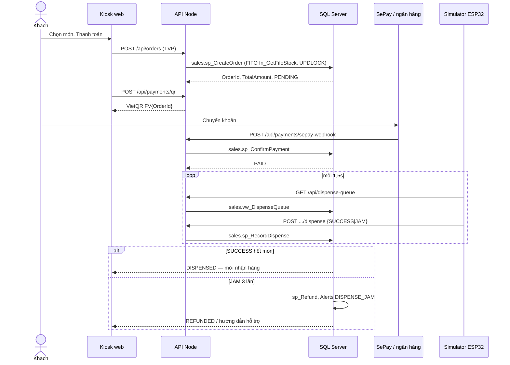
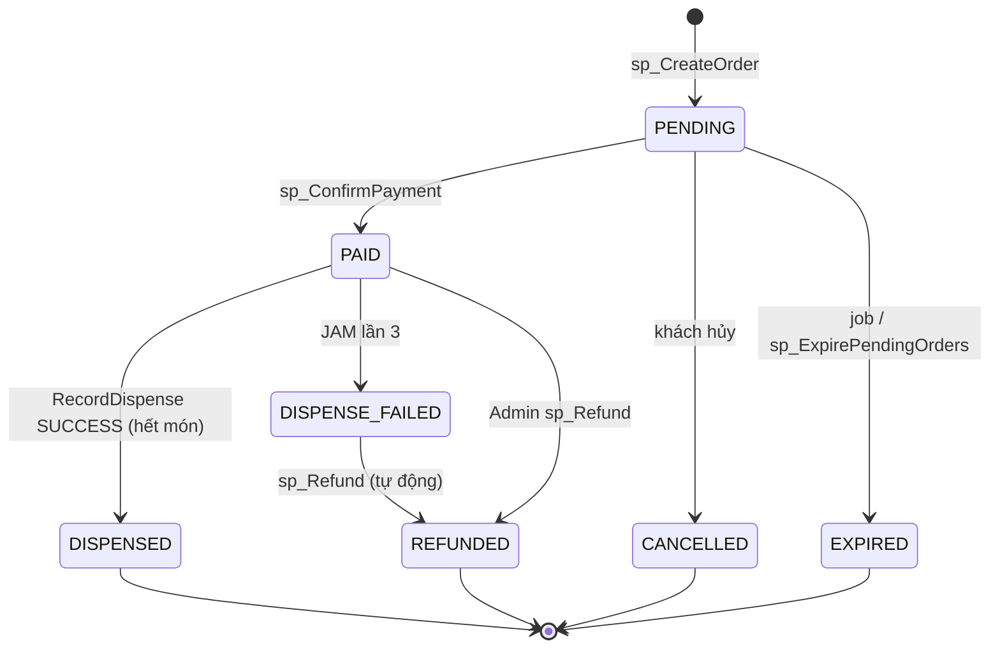

# FreshVend — Detailed Design (TV3 / FV-26 SCRUM-220)

Tài liệu đặc tả API, luồng mua hàng và trạng thái đơn. Nguồn: `app/api/src/routes/*`, `/api-docs`, `docs/State.drawio`, `sql/12_procs_sales.sql`.

Đếm route: **56** (khớp check-sync / OpenAPI). File máy: `docs/openapi.json`.

## 1. API Specification

Mọi thao tác **ghi** gọi stored procedure. **Đọc** qua view. Hai lớp quyền: JWT/vai trò ở API + GRANT/RLS trên SQL (FV-22).

### 1.1 Hệ thống (2)

| Method | Path | Vai trò | SQL |
|--------|------|---------|-----|
| GET | `/api/health` | public | ping pool |
| GET | `/api/openapi.json` | public | — (sinh spec) |

Swagger UI: `http://localhost:3000/api-docs`.

### 1.2 Auth TV1 (8)

| Method | Path | Vai trò | Procedure / view |
|--------|------|---------|------------------|
| POST | `/api/auth/login` | public (pool Kiosk) | `auth.sp_Login` |
| GET | `/api/auth/me` | JWT | — |
| PUT | `/api/auth/password` | Admin, Operator, Kiosk | `auth.sp_ChangePassword` |
| GET | `/api/auth/users` | Admin | `auth.vw_UserPermissions` |
| POST | `/api/auth/users` | Admin | `auth.sp_CreateUser` |
| PUT | `/api/auth/users/{id}/active` | Admin | `auth.sp_DeactivateUser` |
| POST | `/api/auth/users/{id}/machines` | Admin | `auth.sp_AssignMachine` |
| GET | `/api/auth/login-activity` | Admin | `audit.vw_LoginActivity` |

### 1.3 Inventory TV2 (13)

| Method | Path | Vai trò | Procedure / view |
|--------|------|---------|------------------|
| GET | `/api/inventory/products` | Admin, Operator | view sản phẩm |
| POST | `/api/inventory/products` | Admin | `inventory.sp_AddProduct` |
| PUT | `/api/inventory/products/{id}` | Admin | `inventory.sp_UpdateProduct` |
| POST | `/api/inventory/products/{id}/image` | Admin | file upload |
| PUT | `/api/inventory/products/{id}/price` | Admin | `inventory.sp_UpdatePrice` |
| GET | `/api/inventory/products/{id}/price-history` | Admin, Operator | `inventory.fn_PriceHistory` |
| GET | `/api/inventory/stock` | Admin, Operator | `inventory.vw_StockStatus` |
| PUT | `/api/inventory/columns/{id}` | Admin | `inventory.sp_AssignColumn` |
| GET | `/api/inventory/batches` | Admin, Operator | lô còn châm |
| POST | `/api/inventory/batches` | Admin, Operator | `inventory.sp_AddBatch` |
| POST | `/api/inventory/restock` | Admin, Operator | `inventory.sp_Restock` |
| GET | `/api/inventory/expiring` | Admin, Operator | lô sắp/hết hạn |
| POST | `/api/inventory/remove-expired` | Admin, Operator | `inventory.sp_RemoveExpired` |

### 1.4 Sales TV3 (14)

| Method | Path | Vai trò | Procedure / view |
|--------|------|---------|------------------|
| GET | `/api/kiosk/menu` | Kiosk, Admin | `inventory.vw_StockStatus`, `iot.vw_MachineHealth` |
| POST | `/api/orders` | Kiosk, Admin | `sales.sp_CreateOrder` (TVP) |
| GET | `/api/orders` | Admin | `sales.vw_OrderDetail` |
| GET | `/api/orders/pending` | Admin | `sales.vw_PendingOrders` |
| GET | `/api/orders/{id}` | Kiosk, Admin | `sales.vw_OrderDetail` |
| POST | `/api/orders/{id}/cancel` | Kiosk, Admin | `sales.sp_ExpirePendingOrders` |
| POST | `/api/orders/{id}/refund` | Admin | `sales.sp_Refund` |
| GET | `/api/dispense-queue` | Kiosk, Admin, Device | `sales.vw_DispenseQueue` |
| POST | `/api/orders/items/{itemId}/dispense` | Admin / Device | `sales.sp_RecordDispense` |
| POST | `/api/payments/qr` | Kiosk, Admin | view đơn + VietQR |
| POST | `/api/payments/sepay-webhook` | public (API key) | `sales.sp_ConfirmPayment` |
| POST | `/api/payments/callback` | public (HMAC) | `sales.sp_ConfirmPayment` |
| POST | `/api/demo/orders/{id}/pay` | Kiosk, Admin | demo only |
| POST | `/api/orders/{id}/confirm-payment` | Admin | `sales.sp_ConfirmPayment` |

### 1.5 IoT TV4 (9)

| Method | Path | Vai trò | Procedure / view |
|--------|------|---------|------------------|
| POST | `/api/iot/telemetry` | Device | `iot.sp_IngestTelemetry` |
| GET | `/api/iot/machines` | Admin, Operator | `iot.vw_MachineHealth` |
| GET | `/api/iot/locations` | Admin, Operator | từ health |
| POST | `/api/iot/machines` | Admin | `iot.sp_RegisterMachine` |
| GET | `/api/iot/machines/{id}/telemetry` | Admin, Operator | `iot.fn_RecentTelemetry` |
| PUT | `/api/iot/machines/{id}/thresholds` | Admin | ngưỡng |
| PUT | `/api/iot/machines/{id}/clear-fault` | Admin, Operator | `iot.sp_ClearFault` |
| GET | `/api/iot/alerts` | Admin, Operator | `iot.vw_OpenAlerts` |
| PUT | `/api/iot/alerts/{id}/ack` | Admin, Operator | `iot.sp_AcknowledgeAlert` |

### 1.6 Report TV5 (10)

| Method | Path | Vai trò | SQL |
|--------|------|---------|-----|
| GET | `/api/reports/kpi` | Admin | view/fn báo cáo |
| GET | `/api/reports/revenue-growth` | Admin | |
| GET | `/api/reports/peak-hours` | Admin | |
| GET | `/api/reports/ranking` | Admin | |
| GET | `/api/reports/cold-chain` | Admin | |
| GET | `/api/reports/revenue-by-location` | Admin | TVF |
| GET | `/api/reports/export.csv` | Admin | + ExportLogs |
| POST | `/api/reports/refresh` | Admin | |
| POST | `/api/reports/run-tests` | Admin | `report.sp_RunAllTests` |
| GET | `/api/reports/test-results` | Admin | |

**Tổng: 2+8+13+14+9+10 = 56.**

## 2. Sequence — mua hàng (Kiosk → API → SQL → Simulator)

Xuất PNG: dán khối mermaid vào draw.io / mermaid.live → `docs/Sequence_MuaHang.png`.

## 3. State diagram đơn hàng

Khớp `sales.trg_Orders_StatusGuard` và `docs/UserStories_Sales.md`.

Không cho chuyển ngược (ví dụ REFUNDED → PAID) — trigger chặn.

## 4. UI wireframe

Chụp khi chạy demo (`http://localhost:3000` và `/kiosk`):

| Màn | File gợi ý |
|-----|------------|
| Đăng nhập admin | `docs/wireframe_admin_login.png` |
| Kiosk chọn hàng + VietQR | `docs/wireframe_kiosk.png` |
| Đơn hàng admin | `docs/wireframe_orders.png` |

Dán ảnh vào PR FV-26. Giao diện nguồn: `app/web/admin.html`, `app/web/kiosk.html`.

## 5. Database (sales)

- Tạo đơn: TVP `sales.OrderItemType (ColumnId, Qty)`.
- FIFO: `inventory.fn_GetFifoStock(@ColumnId)` + `UPDLOCK` trên `Slot` / `SlotStock`.
- Idempotent thanh toán: `GatewayTxnId` unique; lần 2 `IsDuplicate = 1`.
- Nhả: tối đa 3 attempt / dòng; 3× JAM → hoàn tồn + `iot.Alerts`.
