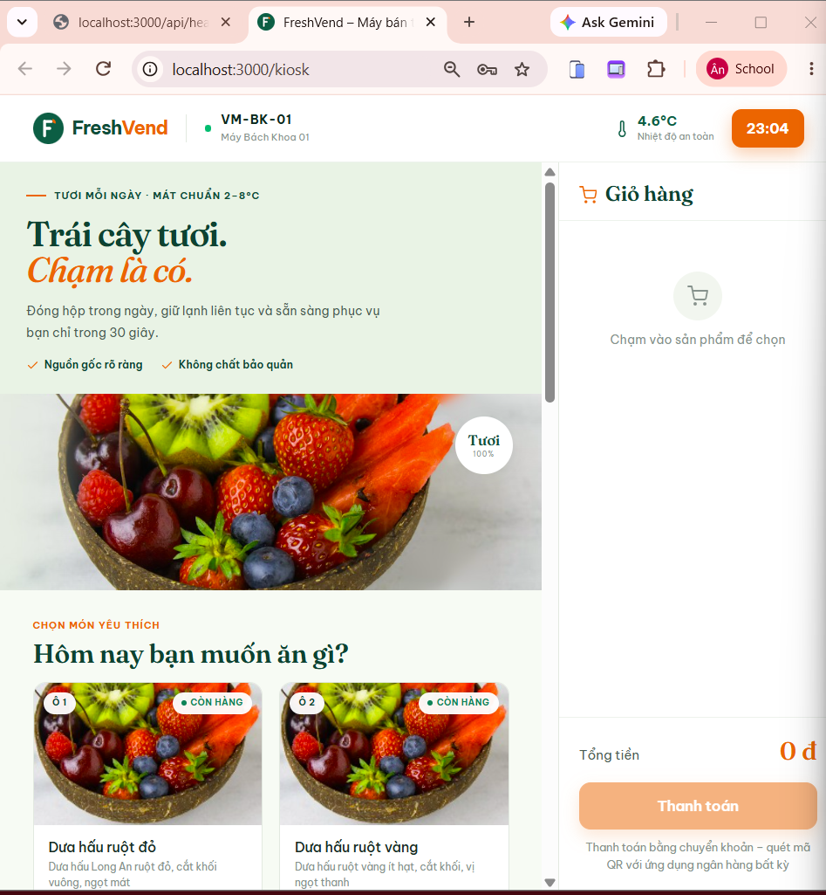
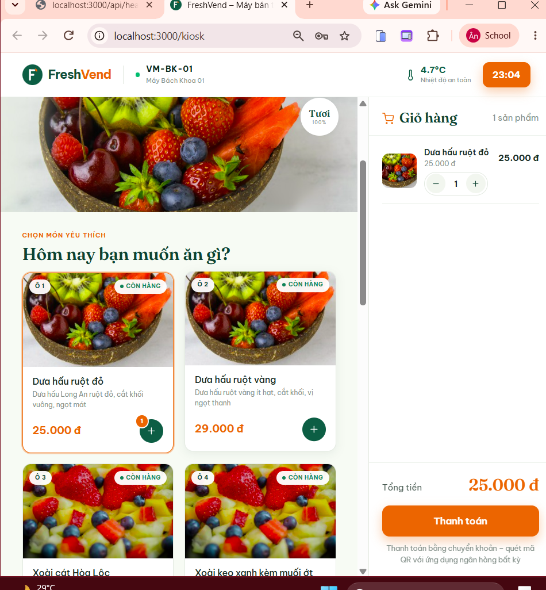
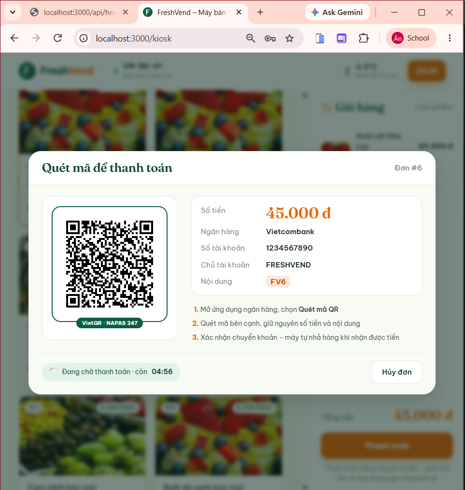
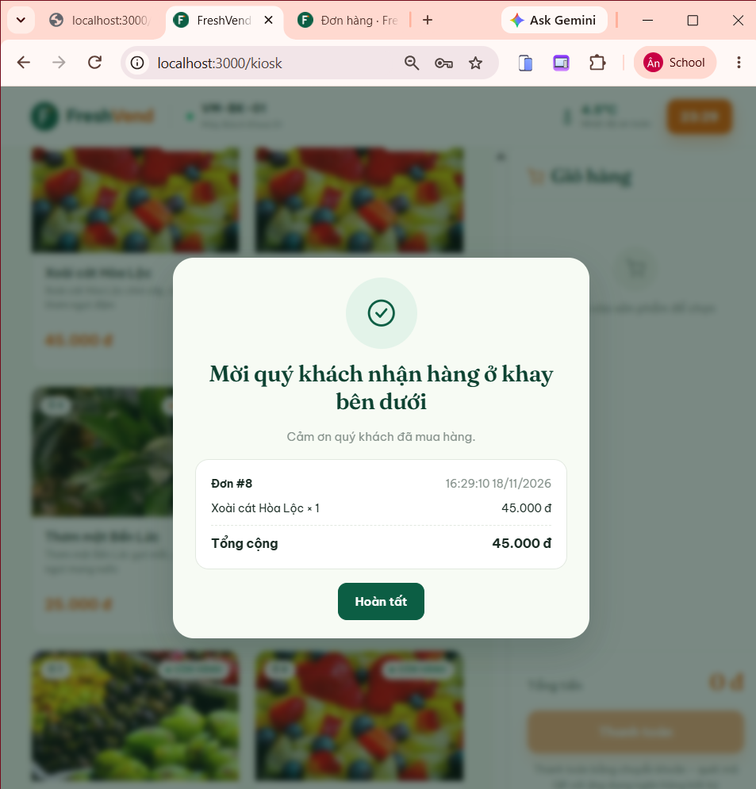
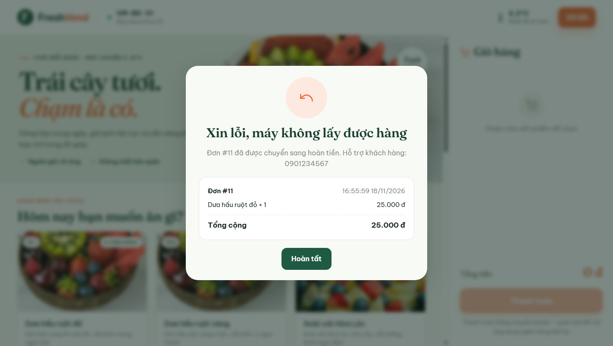
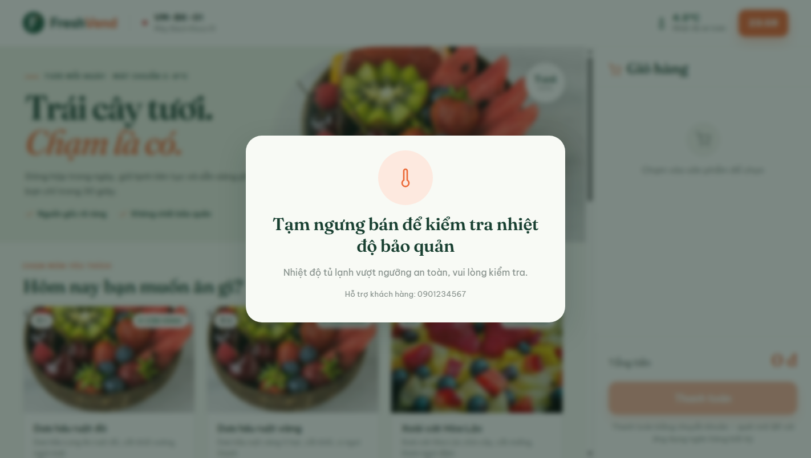

# FreshVend — Hướng dẫn khách hàng (màn hình kiosk)

Phiên bản 1.0 · SCRUM-233 / FV-39. Ảnh chụp lúc máy `VM-BK-01` chạy với cơ sở dữ liệu SQL Server (`DB_MODE=sqlserver`), ngày 18/11/2026.

Khách đứng trước màn hình cảm ứng của máy. Không cần tài khoản. Thanh toán bằng ứng dụng ngân hàng qua mã VietQR. Máy chỉ nhả hàng sau khi hệ thống ghi nhận tiền.

## 1. Chọn món

Màn hình này để xem trái cây đang bán và giá.

1. Đứng trước máy đang có chấm xanh cạnh tên máy, ví dụ `VM-BK-01`.
2. Kéo danh sách, đọc tên, mô tả và giá trên từng thẻ.
3. Thẻ ghi **Còn hàng** là còn bán. Thẻ **Hết hàng** không chọn được.

Nhiệt độ góc phải nằm trong khoảng 2–8°C là tủ đang giữ lạnh. Nếu thấy lớp phủ “Tạm ngưng”, xem mục 6, không chọn món.

## 2. Giỏ hàng

Giỏ hàng để gom món trước khi trả tiền.

1. Chạm thẻ sản phẩm còn hàng. Món xuất hiện ở cột **Giỏ hàng** bên phải, số lượng mặc định là 1.
2. Bấm **+** để tăng, **−** để bớt. Mỗi loại tối đa 5 phần trong một lần mua.
3. Đọc **Tổng tiền**. Nút **Thanh toán** chỉ bấm được khi giỏ có ít nhất một món.

Nếu không chạm màn hình khoảng 90 giây khi chưa thanh toán, giỏ tự xóa. Chọn lại từ đầu.

## 3. Thanh toán QR

Màn này hiện mã để chuyển khoản đúng số tiền và đúng nội dung.

1. Bấm **Thanh toán**.
2. Đối chiếu **Số tiền**, **Ngân hàng**, **Số tài khoản**, **Chủ tài khoản** và **Nội dung** (dạng `FV` kèm số đơn, ví dụ `FV6`).
3. Mở ứng dụng ngân hàng, chọn **Quét mã QR**, quét mã trên màn hình. Giữ nguyên số tiền và nội dung.
4. Xác nhận chuyển khoản trên điện thoại. Màn hình kiosk đếm ngược khoảng 5 phút.

Không tự bấm gì thêm trên kiosk sau khi đã chuyển khoản. Máy tự chuyển màn khi nhận được tiền. Bấm **Hủy đơn** chỉ khi chưa chuyển khoản và muốn bỏ mua. Hết giờ mà chưa nhận tiền, đơn bị hủy và hàng được trả lại máy.

## 4. Nhận hàng

Màn này báo khách lấy hộp ở khay nhả.

1. Sau khi tiền được ghi nhận, màn hình hiện “Đã nhận thanh toán” rồi “Máy đang lấy hàng”.
2. Khi nhả xong, đọc dòng **Mời quý khách nhận hàng ở khay bên dưới** và biên lai: số đơn, tên món, tổng tiền.
3. Lấy hàng ở khay phía dưới máy. Bấm **Hoàn tất**, hoặc đợi khoảng 10 giây để màn hình tự về trang chọn món.

Giữ số đơn trên biên lai nếu hộp không rơi xuống khay. Đưa số đó cho nhân viên khi cần đối soát.

## 5. Kẹt hàng và hoàn tiền

Khi motor kẹt, máy thử nhả lại. Sau 3 lần không lấy được hàng, đơn chuyển sang hoàn tiền.

1. Đọc dòng **Xin lỗi, máy không lấy được hàng**.
2. Giữ số đơn trên màn hình, ví dụ đơn #11.
3. Gọi số hỗ trợ ghi trên màn hình. Không mua lại ngay món vừa kẹt.

Tiền của phần chưa nhả được chuyển sang hoàn. Nếu đã nhận một phần trong đơn nhiều món, chỉ phần kẹt được hoàn.

## 6. Máy tạm ngưng

Khi tủ quá nhiệt, màn chọn món bị che và không thanh toán được.

1. Đọc dòng **Tạm ngưng bán để kiểm tra nhiệt độ bảo quản**.
2. Đọc lý do và số hỗ trợ bên dưới.
3. Sang máy khác hoặc quay lại khi lớp phủ đã tắt.

Không chuyển khoản khi lớp phủ này đang hiện. Nếu máy mất kết nối, dòng chữ là **Máy tạm ngưng phục vụ**.
